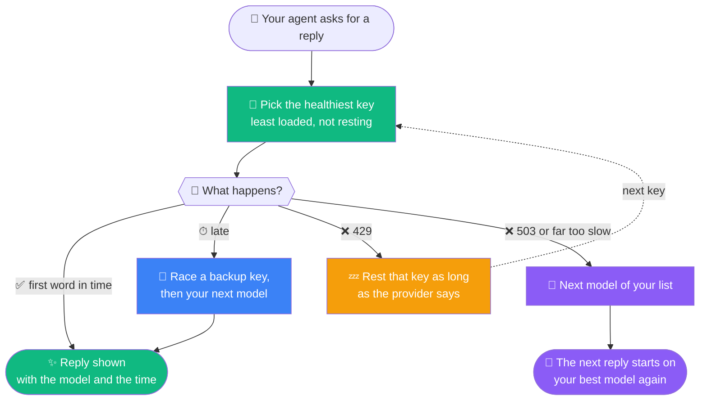
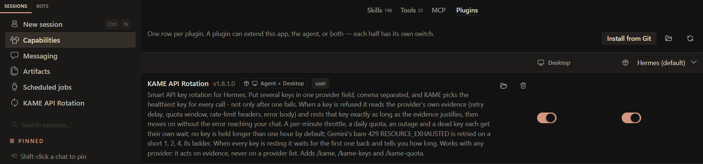
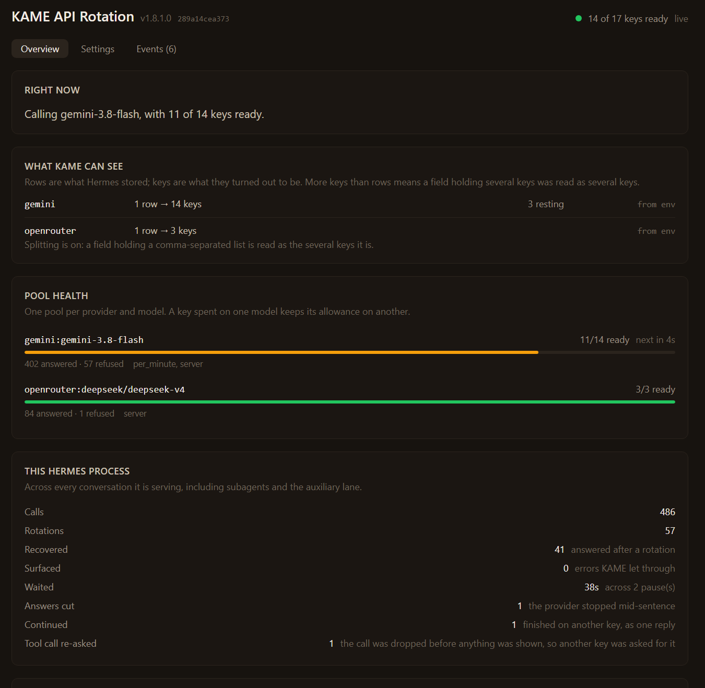
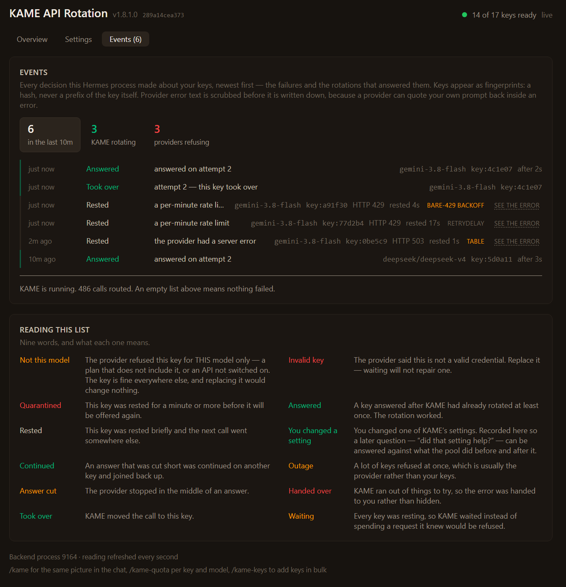
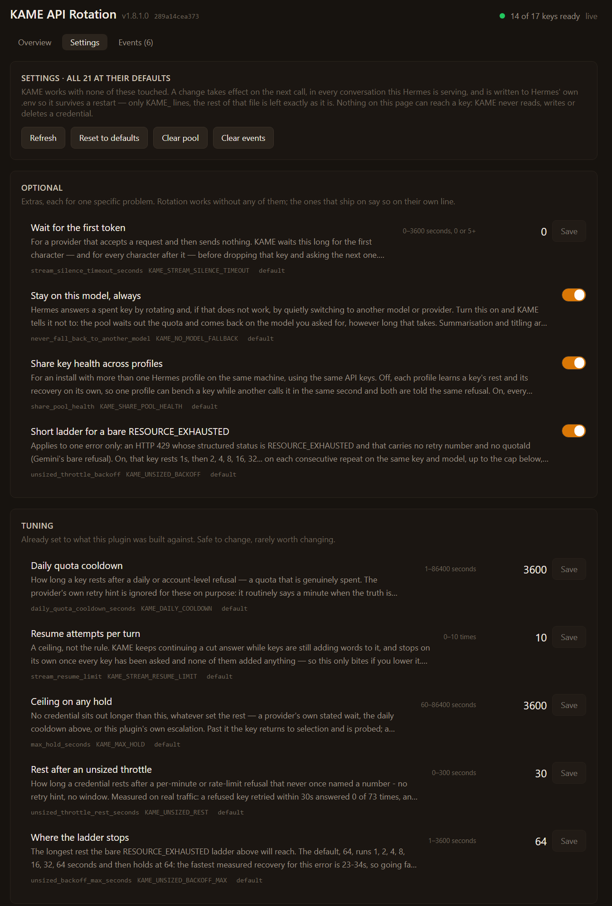

<div align="center">


# 🐢⚡ KAME — free API key rotation for Hermes Agent

### What API key rotation should have been: all your keys and models, one agent that never waits.

[](CHANGELOG.md)
[](#verified)
[](#verified)
[_·_1.8.2.9_submitted-brightgreen.svg)](https://github.com/NousResearch/hermes-agent/pull/141137)
[](#privacy)
[](LICENSE)
[](https://github.com/Kame696/kame-api-rotation-for-hermes/stargazers)

**[⚡ Install in 1 minute](#install-fast) · [🆚 vs round-robin](#vs) · [🔬 How it works](#how) · [🖥️ Screenshots](#screens) · [❓ FAQ](#faq) · [Agent Zero version →](https://github.com/Kame696/kame-api-rotation-for-agent-zero)**

</div>

---

<a id="install-fast"></a>
## ⚡ Install in 1 minute

<table>
<tr>
<td width="33%" valign="top">

### 1️⃣ Install

Download **`KAME-for-Hermes-1.8.3.0-all-in-one.zip`** from the [latest release](https://github.com/Kame696/kame-api-rotation-for-hermes/releases/latest) and unzip it into your Hermes `plugins` folder.

Everything is in it: plugin, model provider and the bridge (status line, "which model answered").

</td>
<td width="33%" valign="top">

### 2️⃣ Enable + restart

```bash
hermes plugins enable hermes-kame-api-rotation
hermes plugins enable hermes-kame-bridge
```

Then restart Hermes once.

</td>
<td width="33%" valign="top">

### 3️⃣ Add your keys

In the chat:

`/kame-keys add gemini KEY1,KEY2,KEY3`

Everything else is **automatic**. Optional: turn on the panel in Desktop **Settings → Plugins**.

</td>
</tr>
</table>

<sub>Prefer the command line? <code>hermes plugins install Kame696/kame-api-rotation-for-hermes/hermes-kame-api-rotation</code>, then the same for <code>hermes-kame-provider</code> and <code>hermes-kame-bridge</code>. Details in [Install](#install).</sub>

## 🎯 Why people switch to KAME

Round-robin tools cycle your keys blindly and keep hitting the one that just failed. **KAME decides from the error itself** — and it never makes your agent wait for a slow model.

<table>
<tr>
<td width="50%" valign="top">

### ➕ Your quotas add up
Many free-tier keys, from many projects and accounts, become **one big pool**. 14 Gemini projects = 14× the free quota.

</td>
<td width="50%" valign="top">

### 🛡️ Never stuck on a 429
A `429`, `RESOURCE_EXHAUSTED`, a `503` or a dead key moves the call to the **next healthy key at once**. A resting key comes back by itself.

</td>
</tr>
<tr>
<td width="50%" valign="top">

### ⚡ Speed first
A late reply is **raced** by a backup key, then by your **next model**. Whichever answers first is shown, the rest is cut.

</td>
<td width="50%" valign="top">

### 🔀 Smart model fallback
Your best model **leads every reply**. A busy, spent or slow one hands over in seconds, and is tried first again soon after.

</td>
</tr>
<tr>
<td width="50%" valign="top">

### 🧠 Reads every error
The provider's **own retry time**, per-minute vs daily vs out of credit. **82 providers** learned from their own docs, no allowlist.

</td>
<td width="50%" valign="top">

### 👀 You see everything
Which **model answered** each reply and how long it took. A live panel with every key, rest and switch.

</td>
</tr>
</table>

## 🏎️ How fast? Measured live

On the author's own Gemini free-tier keys (4 fallback models × 14 keys), on a bad day for the newest model:

| Situation | Before 1.8.2.8 | **KAME 1.8.2.8** |
|---|---|---|
| Main model is **slow** (about 2 minutes for one word) | 46–120 s per reply | **2.6 s median** |
| Main model is **overloaded** (503) | stuck on it | next model answering in **8.3 s**, then at once |
| Main model is **out of quota** | next model, then stuck there up to 1 hour | switched in **0.3 s**, back on your best model next reply |
| Everything **healthy** | — | your main model, first word in **2–4 s** |

<sub>Measured on the Hermes build, which shares these rules; 8 messages in one session. See <a href="VALIDATION.md">validation and limits</a>.</sub>

<a id="vs"></a>
## 🆚 KAME vs round-robin

Most key rotators cycle keys in order and retry on a timer. KAME decides from the refusal itself.

| | Round-robin rotator | **KAME** |
|---|---|---|
| Which key is next | the next one in the list | **the least-loaded healthy key** (60-second window) |
| After a 429 | retry on a fixed backoff | **the provider's own `retryDelay` / `Retry-After`, to the second** |
| Per-minute vs daily quota | same treatment | **told apart** (`quotaId`, reset headers, the pool's own behaviour) |
| Gemini bare `RESOURCE_EXHAUSTED` | fixed backoff or hammering | **1 → 2 → 4 → 8s … ladder, reset the moment the key answers** |
| Outage (5xx) | punishes every key | **1s, never escalates** — the key was never at fault |
| A key spent on one model | benched everywhere | **still used on your other models** |
| All keys resting | error, turn over | **waits for the first one back, and says so** |
| Longest a healthy key can be lost | whatever the provider claimed | **1 hour** (`max_hold_seconds`) |

<a id="how"></a>
## 🔬 How it works



<table>
<tr><th>Step</th><th>What KAME does</th></tr>
<tr><td>🔑 Pick</td><td>The key with the fewest requests in the last 60 s; a key is marked busy the moment it is handed out, so parallel agents spread across keys.</td></tr>
<tr><td>🏁 Race</td><td>Silent at about 2× the usual first word: a backup key of the same model. At about 3×: your next model also gets the request. First to answer wins.</td></tr>
<tr><td>💤 Rest</td><td>Exactly as long as the provider says, never more than an hour. A spent key still works on your other models.</td></tr>
<tr><td>🔀 Fallback</td><td>Your Hermes fallback list (`hermes fallback add`). Only models <b>you</b> listed, never after part of the reply is on screen, only for a reply that started on your main model, and every new reply starts on your best one.</td></tr>
</table>

<details>
<summary><b>📣 What's new in 1.8.3.0 and the versions before it</b></summary>

**1.8.3.0 — the fallback list belongs to your main model, and the selector stays on it.**

- **Fallback only for your main model.** The list is used only for a reply that started on the model
  in your Hermes configuration. Pick another model for a conversation (or a model that is itself in
  your list) and that reply stays on it: no switching, no racing, no stand-in.
- **The main model stays on the selector.** When the next model of your list is on the same
  provider, KAME answers with it itself (the notice says "X answered for Y") and Hermes never
  switches, so the selector never moves. For a model of another provider Hermes still switches; the
  desktop page then sets your main model back on that conversation's selector when the reply
  ends. It never changes your default model. Hermes keeps its own backoff (60 s, doubling) before
  it returns to the main model by itself, and KAME cannot shorten that.
- **Request errors are not blamed on your keys.** A "400 unsupported parameter" goes back to Hermes
  after the first key and rests nothing; an NVIDIA "402 credits exhausted" rests the key for the long
  window.
- **The logs rotate.** `calls.jsonl` and `refusals.jsonl` keep the current file and one previous one
  instead of going silent at 4 MB / 8 MB.

**1.8.2.9 — back to your best model, a quiet gateway, side jobs on a budget, a rotation page you can read.**

- **Back to your best model.** When the model in use is busy and nothing after it in your fallback
  list is free, KAME goes back up the list, best first, one request at a time, asking a busy model
  again at most every 20 s. The busy best model is also asked *beside* the reply (never delaying
  it): if it answers first, it is shown.
- **No reply behind two silent models.** The wait behind a silent best model plus a silent next
  model is shorter (24 s instead of 34 s, 56 s instead of 79 s in the bench), one more model of
  your list joins at the slow bound, and when nothing else could answer, nothing is cut.
- **Background jobs get a budget.** One title once made 167 attempts in 12 minutes on the best
  model. A title now sends at most 3 requests in 30 s, other side jobs at most 6 requests or 5
  minutes, and a stopped job moves down *your* list through Hermes. Your chat keeps its wait.
- **Where your quota went.** The panel shows how much of each model's requests were side jobs and
  says in words which job you could move to which model of your list. KAME never edits your config.
- **Nothing idle burns your CPU.** The four plugin copies a gateway loads re-parsed `config.yaml`
  every few seconds: about 30% of a core with nothing happening, about 6% now.
- **Speed in plain words.** Saver · 1x, Balanced · up to 1.1x, Faster · up to 1.3x. *Faster*
  replaces *Fastest*, which doubled the requests of every reply and could use up a whole pool.
- **A rotation page you can read.** Three sentences, one ring per model with a segment per key,
  what KAME did, the three controls you reach for, *Wake this model* and *Try this model now*.
- **Works on a stock Hermes.** The fallback list is read with Hermes' own YAML reader, then
  PyYAML; the reviewer-found `import yaml` defect is gone.

A healthy reply is not faster than in 1.8.2.8 (measured: within noise). The gains are in the
bad hours: fewer wasted requests, shorter waits behind silent models, a quieter machine.

**1.8.2.8 — speed first: median reply 2.6 s live on a day the newest Gemini took 2 minutes per word.**

- **A busy provider no longer holds your agent.** Two keys in a row answering "the model is
  overloaded" (or timing out) mean the model is busy, not your keys: the reply falls back to
  the next model of your list at once. Before, a 503 rested each key one second, the "every
  key resting" clock never moved, and the agent waited.
- **Your fallback list is one big pool, best model first.** Every reply starts on your best
  model and uses all of its keys; it goes down the list only when that model is busy, every
  key is resting, or nothing comes back in time — and the next reply starts at the top again.
  A model KAME knows is still busy or resting is passed down without spending a request, and
  Hermes' "⚠️ Model fallback … recovery is not guaranteed" line stays out of the chat for
  these planned switches (with `hermes-kame-bridge`).
- **Speed first: the next model races a late reply.** Silent past ~3 × its usual first word
  (8 s at least), a reply also asks the next model of your list; the first to answer is
  shown. Your best model sits out only 30 s after losing, so it leads again almost at once.
- **A slow model is passed on too.** A reply with no sign of work by the model's own slow
  bound (learned: 20–45 s, thinking models 25–60 s) falls back to the next model — live, the
  owner's gemini-3.8-flash took two minutes for one word while gemini-3.7-flash took three
  seconds. The last model of your list is always waited for.
- **Automatic by default.** *Fallback*, *Wait for the first token* and *Speed* are choices
  now, not numbers to guess — KAME learns each model's usual first-word time and sizes both
  waits from it. "Set time" is still there for anyone who wants a fixed number.
- **You see who answered.** After each reply the Desktop shows the model that wrote it and
  how long it took — "gemini-3.7-flash answered for gemini-3.8-flash" when a fallback
  model stood in — and the Events tab opens with your last replies.
- **Backups keep racing through an overload** — only keys resting for quota count as
  pressure now, not keys resting a second for a 503.

**1.8.2.7 — every provider learned, your fallback list used by itself, fast when quota runs dry.**

- **82 providers learned from their own documentation**, graded against answer keys written
  by reviewers who never saw the code (774 error shapes). Every provider native to Hermes
  (42) and to Agent Zero (29) is covered, plus the free and free-after-top-up ones
  (OpenRouter, AIHubMix, Groq, Cerebras, NVIDIA, Mistral, Cloudflare, SambaNova, …).
  Decisions read the response, never the provider's name.
- **Your Hermes fallback list works by itself.** Set fallback models with
  `hermes fallback add`; when every key of your model is resting for more than a minute,
  KAME hands the call over at once and Hermes answers with the next model — then comes
  back to your model as soon as its keys return. No list, no switching. Proven live:
  four spent models skipped in 0.2 s, the fifth answered.
- **Fast when quota runs dry.** When keys start refusing for a spent daily quota, KAME asks
  4, then 8, then 16 keys at once instead of one by one: the hourly re-check of a spent
  14-key pool went from ~59 s to ~13 s on real refusal timings.
- **Honest timeouts.** A timeout says nothing about the key: no punishment, one quick
  rotation, then Hermes decides.
- **A panel anyone can read**, and one that no longer goes blank: four settings on show,
  the rest tuned automatically; your fallback list with each model's keys; how to add keys.

**Since 1.8.2.2 (the catalog version)** — 1.8.2.3 to 1.8.2.6, all included:
backup requests raced to the first word on the chat itself (worst first word 33 s → 7.4 s
on Gemini), pacing learned from real 429s, latency-aware key choice, a Background-jobs tab
so titles and compression no longer bury your conversation, and clear words for every
event.

**1.8.2.2 — the same carousel, with no runtime overrides of Hermes, and
nothing given up for it.** Hermes asks a provider profile for its model client
(`ProviderProfile.create_client`, the documented way to bring a transport), and
the companion package `hermes-kame-provider` answers with a client that rotates
your keys. No Hermes module, class or dict is rebound. The Desktop panel uses
only `@hermes/plugin-sdk`, through its own backend route.

Every rotation, wait, refusal-sizing and continuation decision is 1.8.1.8's.
The Events tab now shows every call and every answer, not only failures.
Multi-key variables sync on the newest Hermes, whose profile-scoped secrets
broke the sync in 1.8.1.9.

**Two Hermes seams that are not merged yet.** KAME uses each one as soon as
your Hermes has it:

| Seam | Hermes PR | Without it |
|---|---|---|
| `notify_turn_status` | [#133474](https://github.com/NousResearch/hermes-agent/pull/133474) | The live status line (`⏳ waiting on … — KAME 13/15 keys healthy`) appears only above the Desktop composer, not on the spinner. |
| `create_messages_client` | [#133461](https://github.com/NousResearch/hermes-agent/pull/133461) | On the Anthropic Messages wire (Anthropic, MiniMax, Kimi coding), KAME sizes each refusal but does not pick the key per call. |

Until both are merged, `hermes-kame-bridge` adds them (install it — see below). It is
not part of the Hermes catalog entry, because it patches Hermes.

See [validation and limitations](VALIDATION.md) and [release notes](CHANGELOG.md).

</details>

<a id="install"></a>
## 🚀 Install

```bash
hermes plugins install Kame696/kame-api-rotation-for-hermes/hermes-kame-api-rotation
hermes plugins install Kame696/kame-api-rotation-for-hermes/hermes-kame-provider
hermes plugins install Kame696/kame-api-rotation-for-hermes/hermes-kame-bridge
hermes plugins enable hermes-kame-api-rotation
hermes plugins enable hermes-kame-bridge
```

`hermes-kame-api-rotation` is the carousel, the commands and the panel; `hermes-kame-provider` (a `model-provider` plugin, loaded by Hermes on its own) is how Hermes asks it for a client — both are needed, either one alone changes nothing. **`hermes-kame-bridge` gives you everything today**: the live status line on the spinner, the "which model answered" notice, no "⚠️ Model fallback" line for KAME's planned switches, and key rotation on the Anthropic Messages wire — without waiting for Hermes to merge its two seams. It installs each piece only where your Hermes lacks it, so it stays harmless after Hermes catches up. The same three ZIPs are on every [release](https://github.com/Kame696/kame-api-rotation-for-hermes/releases/latest).

Then **restart Hermes** once. For the Desktop panel and the status-bar chip, turn on **KAME API Rotation** in Desktop **Settings → Plugins** (the panel ships inside the package at `desktop/plugin.js`; Desktop keeps it off until you say so — [step by step, with a screenshot](#panel)).

| | |
|---|---|
| **Needs** | Hermes 0.21.4 or newer, and nothing else — no third-party package |
| **Works without the Desktop** | yes; rotation is CLI- and gateway-safe, the panel is extra |
| **Turn it off without uninstalling** | `KAME_ROTATION_DISABLED=1`, or the first switch in the panel |

<a id="keys"></a>
## 🔑 Add your keys

Paste them into **one** provider field, separated by commas — in the dashboard or in `~/.hermes/.env`:

```
GOOGLE_API_KEY=AIzaSy...aaa,AIzaSy...bbb,AIzaSy...ccc
```

That is all KAME needs. One key works too; there is just nothing to rotate to.

KAME keeps such a list as one pool entry per key on its own, at every start, and follows the variable when you edit it (turn off with `resolver_disabled`). It writes through Hermes' own pool API, suppresses the comma source, backs up `auth.json` first, and never rewrites `.env`. `/kame-keys split` does the same once by hand.

<details>
<summary><b>Bulk import from any chat, including the Android app</b></summary>

```
/kame-keys add AIza...,AIza...,AIza...
/kame-keys add openrouter sk-or-...,sk-or-...
/kame-keys import ~/keys.txt
/kame-keys                       show pooled keys and their health
/kame-keys reset                 clear exhaustion, re-enable every key
```

Commas, spaces, newlines, semicolons and pipes all separate keys. Keys already pooled are skipped. A key is never echoed back — every message shows it as `AIzaSy…q7R8`. Pasting keys into a chat puts them in that chat's transcript; `import <file>` avoids that.

`add`, `import` and `split` write the new keys to `~/.hermes/auth.json` (Hermes' own credential store). Before each write KAME saves a plaintext copy of the previous file beside it as `auth.json.kame-<timestamp>.bak`, keeping the last 5 — those backups hold your keys in plain text, like `auth.json` itself.
</details>

<a id="panel"></a>
## 🖥️ Turn on the panel (optional)

Rotation works as soon as your keys are in. The Desktop panel and the sidebar entry are extra, and Desktop keeps them **off until you turn them on**:

1. In Hermes Desktop open **Capabilities → Plugins**.
2. Find **KAME API Rotation** and switch on **Desktop** (the *Agent* switch is the rotation itself).
3. **KAME API Rotation** appears in the left sidebar, with the status chip in the bar.

<p align="center"></p>

<a id="errors"></a>
## 🧠 How KAME reads every error

Every refusal is sized from what the provider actually sent. Decisions are made on the payload, never on the provider's name, so a provider that did not exist when this was written is covered by the same rules.

| The provider says | KAME does |
|---|---|
| **429 with a stated wait** (`retryDelay`, `Retry-After`, a reset header or time) | rests that key **exactly that long**, up to the 1-hour ceiling |
| **Gemini `429 RESOURCE_EXHAUSTED`, no number at all** | rests it **1s, then 2, 4, 8, 16, 32, 64s** on each repeat; back to 1s the moment it answers |
| **Any other throttle with no number** | a short flat rest, **20–30s** — measured: retried within 30s, a refused key answered 0 of 73 times |
| **A daily quota** (e.g. `PerDay` in `quotaId`) | re-probes in **5 minutes** while other keys still answer; rests **1 hour** once the whole pool has been silent for 20 minutes |
| **An account-wide limit** (a subscription cap) | benches that credential on **every model** of the provider, up to the ceiling |
| **Out of credit** | **1 hour** — a person has to top it up |
| **5xx / overloaded** | **1 second**, never escalates — an outage is not the key's fault |
| **Timeout / dropped connection** | moves to the next key; the key is not rested at all |
| **Bare 401** | 20s, offered last, out of rotation after 3 in a row |
| **"This key is invalid / revoked"** | out of rotation at once — replace it and it comes back by itself |
| **403 for one model only** | that key skips that model and keeps working on the others |
| **An answer cut mid-stream** | continued on another key and joined back into one reply |
| **Anything it cannot size** | left to Hermes' own classifier, unchanged |

<a id="screens"></a>
## 🖥️ What you see

**The status-bar chip**, always on screen — the pool being called first:

```
●  KAME  gemini:gemini-3.8-flash 11/14 4s   openrouter:deepseek/deepseek-v4 3/3
```

**The in-chat line** above the Desktop message box while a call waits or is being continued — `⏳ waiting on gemini:gemini-3.8-flash — KAME 13/15 keys healthy`. (CLI, TUI and gateway clients have no plugin channel for it; the chip, `/kame` and `/kame-quota` show the same state.)

**The panel** (`/kame`, or *KAME API Rotation* in the sidebar) — **POOL HEALTH** per provider and model, what each key is doing, every decision and where its number came from:

<p align="center"></p>

<details>
<summary><b>Events — every rotation, and where each wait came from</b></summary>

<p align="center"></p>
</details>

<details>
<summary><b>Settings — three labelled shelves, live, no restart</b></summary>

<p align="center"></p>
</details>

<sub>Rendered from the plugin's own panel code with sample data. Keys appear only as fingerprints, so every screen is safe to share.</sub>

<a id="settings"></a>
## ⚙️ Settings

Nothing needs changing. Every setting is in Desktop **Settings ▸ Plugins ▸ KAME API Rotation**, in `/kame set`, and as an environment variable. When the same setting is set in more than one place, the environment variable wins.

<details>
<summary><b>The ones worth knowing</b></summary>

| Setting | Default | What it does |
|---|---|---|
| `max_hold_seconds` | `3600` | No key sits out longer than this, whatever caused the hold |
| `max_total_wait_seconds` | unset | *Give up after* (advanced). Unset: a chat waits for as long as it takes, and a cron run stops after 300 s with the provider's refusal. Set it to `0` for no bound anywhere, or to a number to bound both |
| `unsized_throttle_backoff` | on | The 1-2-4-8s ladder for Gemini's bare `RESOURCE_EXHAUSTED` |
| `unsized_backoff_max_seconds` | `64` | Where that ladder stops growing |
| `unsized_throttle_rest_seconds` | `30` | Rest after any other throttle that names no wait |
| `daily_quota_cooldown_seconds` | `3600` | Rest once a daily quota is confirmed by a silent pool |
| `model_switch` | `auto` | *Fallback*. With a fallback list in Hermes, one pool with your best model first: a reply falls back to the next model at once when your provider is busy, at once when every key is resting, otherwise after about three times your model's usual first-word time (6–20 s, learned); every reply starts on your best model again. `timed` ("Set time") uses the number below; `never` waits for your keys |
| `failover_after_seconds` | `60` | *Fallback after*. With `model_switch: timed`: seconds a reply waits with nothing on screen before it falls back to the next model |
| `reply_notice` | `always` | After each reply, a Desktop notice naming the model and its time; `switches` only when a fallback model answered; `never` |
| `never_fall_back_to_another_model` | off | On: ignore your Hermes fallback list and always wait for your keys |
| `share_pool_health` | on | Several Hermes profiles with the same keys share one health file |
| `stream_resume_limit` | `-1` (automatic) | Continue while new answer content arrives; `0` disables recovery, `1`–`10` set an explicit ceiling |
| `first_token_wait` | `auto` | Wait for the first token: `auto` drops a key that stays silent far past its model's usual first word (20–120 s, 60–300 s for thinking models; streams only; never a local model); `timed` uses the number below; `off` |
| `stream_silence_timeout_seconds` | `0` | With `first_token_wait: timed`: seconds a key may stay silent |
| `hedging_disabled` | off | Stop backup requests everywhere (chat and background calls) |
| `hedge_mode` | `adaptive` | Speed — Saver · 1x (`off`) one request per reply; Balanced · up to 1.1x (`adaptive`) races a second key only when a reply is late; Faster · up to 1.3x (`max`) races a little sooner and more often, and steps back to Balanced for 10 minutes when a key hits a rate limit. The multipliers follow `hedge_budget_pct` |
| `hedge_budget_pct` | `10` | Long-run ceiling on extra requests, as a share of calls |
| `hedge_max_legs` | `3` | 1 = no backups, 2 = one backup, 3 = a chat reply still silent may try a third key |
| `probe_burst_max_legs` | `16` | When quota runs dry, at most this many keys asked at once (`0` = one by one) |
| `disabled` | off | Turn KAME off without uninstalling (`KAME_ROTATION_DISABLED=1`) |

The panel explains every one of them in full, with its environment variable.
</details>

<a id="commands"></a>
## 💬 Commands

| Command | What it answers |
|---|---|
| `/kame` | Pool health, this process's counters, what is resting and until when, and the build fingerprint |
| `/kame doctor` | Is it rotating correctly? Every kind of refusal beside the rest it got, and anything only a person can fix |
| `/kame get` · `/kame set <key> <value>` · `/kame reset <key>` | Read and change settings, live |
| `/kame events` | The latest rotations, rests and cut streams |
| `/kame-quota` | The quota picture per key and per model |
| `/kame-keys` | Add and inspect pooled keys in bulk; `split` gives each key of a comma list its own pool entry |

<a id="privacy"></a>
## 🔒 Privacy

- **KAME never prints, logs or sends a key.** Screens and files carry fingerprints and counts only.
- **No telemetry, no network call of its own, no third-party package.**
- **It asks Hermes for no special permission** — no tool override, no model override, nothing to grant.
- Its local logs (`refusals.jsonl`, `calls.jsonl`) hold provider refusals and timings with keys redacted, and each can be switched off.

<a id="verified"></a>
## ✅ Verified

**1.8.3.0** (2026-10-29), see the [changelog](CHANGELOG.md):

| Check | Result |
|---|---|
| Plugin suite | **3,543 passing** in the development tree, 342 skipped, 1 failing that reads the author's own recorded evidence and fails the same way on 1.8.2.9 |
| Host gates | `host_prose` ok; `host_corpus` on a copy of the real Hermes: 200 of 200 alone, 196 of 200 with KAME = the same 4 intentional verdicts as 1.8.2.9, nothing new; `host_assumptions` unchanged |
| Fallback only for the main model | a reply that started on another model never uses the list; a reply Hermes walks down the list keeps its permission (25 checks) |
| Selector stays on the main model | a same-provider fallback answers inside KAME with no hand-over; the page sets the main model back for that conversation only (21 checks, run in node) |
| Request errors | four recorded NVIDIA "unsupported parameter" 400s are handed back after the first key with no rest; a 402 reads as a spent account |
| Logs | rotation checked through the real writers (current + one previous generation, first-word history across both) |

**1.8.2.9** (2026-10-24), see the [changelog](CHANGELOG.md):

| Check | Result |
|---|---|
| Plugin suite | **3,472 passing** in the development tree. Run from this repository, 19 tests fail because they read research data that is not published here (provider answer keys, build contracts); they fail the same way on 1.8.2.8 |
| `hermes plugins doctor` | **pass** for `hermes-kame-api-rotation` and `hermes-kame-bridge` on a stock Hermes |
| Host gates | `host_prose` ok; `host_corpus` on a copy of the real Hermes: 200 of 200 alone, 196 of 200 with KAME = the 4 intentional verdicts only; `host_assumptions` unchanged |
| Installed copy | four Hermes profiles, same build fingerprint, `live_daily` passes; real replies answered with the newest Gemini models busy |
| Idle CPU of the plugin's four heartbeats in one gateway | about 30% → about 6% of one core, measured per thread on the running process |
| Healthy reply speed vs 1.8.2.8 | within noise (alternating runs); the gains are in busy hours, not on a healthy reply |
| Side job budget | a title that made 167 attempts in 12 minutes now stops at 3 requests in 30 s (replayed from the recorded state) |

**1.8.2.8** (2026-10-17), see the [changelog](CHANGELOG.md):

| Check | Result |
|---|---|
| Plugin suite | **3285 passing**, 0 failing (the two load-sensitive gate tests pass alone) |
| The owner's case, end to end | a model answering 503 "overloaded" on two keys hands the call to the next model of the list after those two requests, not after the whole pool; without a list the keys keep rotating one at a time |
| Host assumptions | Hermes still reads the hand-over's `reset_at` as the cooldown and its retry backoff never does (4/4) |
| Expected-decision gate (real recorded traffic) | family agreement 99.76 %, unchanged |
| Live on the author's base profile, real Gemini free-tier keys, 4 fallback models × 14 keys (2026-10-18) | healthy first model: every reply on it, first word 2–4 s; first model out of quota: handed over in 0.2–0.3 s, reply in 6–7 s, and the next reply after it is back is its own again; first model slow (gemini-3.8-flash 1 m 46 s – 2 m 18 s for one word on every key, the next one 14–47 s): median reply **2.6 s** over 8 messages (7 of 8 at 2.2–2.8 s), was 46–120 s; a 503 "overloaded" storm: handed over in 6.3 s, answered at 8.3 s (1.8.2.7 never moved); no "⚠️ Model fallback" line in any reply |

**1.8.2.7** (2026-10-17):

| Check | Result |
|---|---|
| Plugin suite | **3,196 passing**, 0 failing |
| Provider answer keys | 82 providers, 774 documented error shapes; regression floors in the suite |
| Fallback list, live (Gemini 3.8 → 3.7 → 3.6 → 3.5 → 3, 14 keys each, real keys) | one spent model: switched in 0.2 s; four spent: all skipped in 0.2 s, the fifth answered; keys back: the first model answered again |
| Dry pool, real refusal timings | first turn 58 → 27 s, hourly re-check 59 → 13 s, every next turn one request |
| Two independent adversarial reviews | every finding fixed and pinned by a test |
| Installed copies | four Hermes profiles, same build fingerprint, `live_daily` 13/13 on each |

**1.8.2.5** (2026-10-12), see [BUILD-1.8.2.5-CONTRACT.md](BUILD-1.8.2.5-CONTRACT.md):

| Check | Result |
|---|---|
| Plugin suite | **3,067 passing** (the two load-sensitive gate tests pass alone) |
| Stream race tests | 27, real threads, incl. the Anthropic Messages wire; stable over repeated runs |
| Concurrency stress | 1,080 streamed calls on 12 threads with slow, empty, 429, 503 and cut replies: no internal error, no thread left behind |
| Real keys, Gemini (14 keys) | alternating raced / unraced replies: worst first word 7.4 s vs 33.0 s (forced triggers), 16.5 s vs 27.1 s (learned) |
| Real keys, NVIDIA (2 keys) | thinking replies are not raced; no slowdown |
| Installed copies | three Hermes profiles, same build fingerprint, `live_daily` 13/13 on each |

The section below is the 1.8.2.2 certification on a Hermes copy.

1.8.2.2, on a copy of Hermes `56f7986` (main of 2026-10-05). Local fake
providers, except the real-key row. Details in [VALIDATION.md](VALIDATION.md).

| Check | Result |
|---|---|
| `hermes plugins validate` (the two catalog packages) | **pass**, `no core override` and `desktop surface` included |
| Real Hermes turns vs 1.8.1.8, six scenarios × four wires | **every turn answered** on native Gemini, OpenAI chat and Responses, with faster steady turns. On the Anthropic Messages wire this needs `create_messages_client` (#133461 or the optional bridge); with it, every turn is answered |
| Status line on the spinner | present with #133474 or the optional bridge. Otherwise it appears above the Desktop composer |
| Real keys (NVIDIA, 2 keys) | 3 of 3 turns answered. One empty answer was rotated to the next key, and the live line showed on the spinner |
| Plugin suite | **2,851 passing** on Hermes `56f7986`, and on Hermes with each upstream seam applied |
| Host gates (classifier corpus, prose) | **pass**, with the corpus keeping its five documented intentional differences |

### Historical validation (not a new-build certification)

1.8.1.6 was installed in the author's running Hermes 0.21.3 gateway (all
three profiles): real agent turns on Gemini 3.8 and NVIDIA Kimi K3 answered
16 of 16, and a replay of 2,634 recorded refusals through 1.8.1.2 and 1.8.1.6
changed no decision. 1.8.1.2 was validated on the running Hermes gateway with real agent turns on
Gemini 3.8 and NVIDIA Kimi K3 across a real daily-quota wall and reset, with a
separate probe measuring how Gemini's per-minute and per-day limits behave.
Daily-traffic evidence and the 0.21.1 gate belong to earlier builds;
Agent Zero runtime validation remains separate. 1.8.1.3 re-ran every offline
host witness in `tools/` against Hermes 0.21.3, 0.21.4 and 0.21.5 installed
from their release tags; it changes no runtime behaviour, so the live-gateway
evidence above still describes what runs.

<a id="faq"></a>
## ❓ FAQ

<details>
<summary><b>Does it work with OpenAI, Anthropic, OpenRouter — not just Gemini?</b></summary>

Yes. KAME decides from the refusal — retry timing, rate-limit headers, the shape of the error body — never from who the provider is.

The whole carousel runs inside the call on every API-key wire: chat completions (Gemini, OpenRouter, NVIDIA, DeepSeek, custom OpenAI-compatible endpoints and the rest), the Responses API (`api.openai.com`, xAI) and Anthropic Messages (Anthropic, MiniMax, Kimi coding). Least-loaded key first, waits, continuation of a cut answer (except on the Responses API, as in 1.8.1.8). Anthropic Messages needs a Hermes that offers `create_messages_client`; an older one builds its own Messages client, and KAME still sizes every refusal there.
</details>

<details>
<summary><b>Why does Gemini say <code>RESOURCE_EXHAUSTED</code> on every key at once?</b></summary>

Gemini's quotas are per Google Cloud project, and a bare `429 RESOURCE_EXHAUSTED` with no `quotaId` and no `retryDelay` often arrives on many keys at the same moment and clears on all of them together — which points at a busy model rather than at your quota. KAME retries those keys on a short 1-2-4-8s ladder instead of benching them, and the first key that answers resets its own ladder.
</details>

<details>
<summary><b>A key was rested for an hour. Is that a bug?</b></summary>

Only a confirmed daily quota or an empty balance rests a key that long. A daily label alone buys a 5-minute re-probe; the hour applies once the whole pool has gone 20 minutes without a single answer. Nothing is ever held longer than `max_hold_seconds`.
</details>

<details>
<summary><b>Does KAME send extra requests to make replies faster?</b></summary>

Only when a reply is stuck. A reply silent for twice its model's usual wait gets one backup on another key (a third if it is still silent), the first key that starts working wins, and the others are cut. Extra requests stay within about 10% of calls, stop by themselves when rate limits appear, and never happen with a single key — so a subscription login with one credential (Anthropic, ChatGPT) is never raced. Turn it off with `hedging_disabled`.
</details>

<details>
<summary><b>Do I need to restart Hermes?</b></summary>

Once, after installing. After that every setting — panel, `/kame set` or a `KAME_*` variable — applies on the next call.
</details>

<details>
<summary><b>I only have one key. Does KAME help?</b></summary>

Yes: the right wait for each error, stream continuation, the live countdown and the one-hour ceiling all apply. It simply has nothing to rotate to.
</details>

<details>
<summary><b>How do I know it is actually running?</b></summary>

`/kame` and the panel header show a 12-character build fingerprint computed from the files on disk. If a part of the plugin is missing, the panel says so in the loudest line on the page.
</details>

---

<a id="history"></a>
## 🪪 Version history

The previous README had an **Evolution** table. It disappeared during the
1.8.1.0 README rewrite; the plugin's older work did not disappear. Restored
below with the newer milestones added. The 1.7.x and 1.8.0.x entries were
development candidates, not public release tags; 1.8.1.3–1.8.1.5 shipped together
inside the v1.8.1.6 release. See [CHANGELOG.md](CHANGELOG.md)
for the full notes on the current public releases.

<details>
<summary><b>Versions and what changed (click to open)</b></summary>

| Version | Focus | What changed |
|---|---|---|
| **1.8.3.0** | Fallback belongs to the main model | The fallback list is used only for a reply that started on your main model; a same-provider next model answers inside KAME so the selector never moves, and the page sets the main model back after a switch to another provider; request-shape 400s are not blamed on keys; NVIDIA 402 reads as a spent account; the two instrument logs rotate instead of going silent. |
| **1.8.2.9** | Best model first again, quiet gateway, side jobs on a budget | The busy best model is asked again, beside the reply; no long wait behind two silent models; titles and other side jobs stop after a few requests and move down your list; the panel shows where your quota went; the idle gateway uses about a fifth of the CPU; speed words with multipliers and *Faster* instead of *Fastest*; a readable rotation page; the fallback list is read on a stock Hermes. |
| **1.8.2.8** | Busy providers, automatic waits, who answered | Two keys "overloaded" or timing out move the reply to your next model at once, and the busy model is left alone for a while; the switch counts your wait, not only the resting time; *Fallback* and *Wait for the first token* are Automatic (learned per model) / Set time / Never-Off; every reply starts on the best model again; a Desktop notice and a *Last replies* list name the model of each reply; backups keep racing through a 503 storm. |
| **1.8.2.7** | Providers, fallback list, dry pools | 82 providers learned from their own docs (774 error shapes, graded by independent answer keys); your Hermes fallback list used by itself after a minute of every key resting, back to your model when its keys return; a dry pool asked 4/8/16 keys at once; honest timeouts; four visible settings, the rest automatic; the panel no longer goes blank. Live-proven on a 5-model Gemini chain. |
| **1.8.2.6** | Events = your conversation | Background jobs (titles, compression, vision) on their own tab, each named; lists scroll in place; a "still waiting" line; plainer words. |
| **1.8.2.5** | Backups for the chat | A streamed reply still silent after twice its model's usual time to first sign of work races a second key (a third after twice that); first to show text, a tool call or reasoning wins, the rest are cut. Triggers learned from `calls.jsonl`, budgeted, off under 429 pressure; a thinking reply is never raced. |
| **1.8.2.4** | 1.8.2.3, working | Backups return at the first useful answer (1.8.2.3 waited for the slow leg); every leg judged on its own key; quota groups match the panel's labels; learned limits can recover; streams timed to first sign; 13 settings declared in the manifest; full suite green again. |
| **1.8.2.3** | The owner's speed pass | Ten integrations: learned pacing, backup requests, latency tiebreak, Secondary Events tab, signature-bound seam check, three-family retry hints, region in pool identity, human-readable settings with a meta-test, string-aware reset, live build line. |
| **1.8.2.2** | Fixes from real use | The Settings form is back on the panel's Settings tab. A setting saved in the panel is in force in every Hermes process. The panel no longer refreshes by itself: one read runs at a time, and a brief backend hiccup keeps the last reading. |
| **1.8.2.1** | Cron bound | Unset, `max_total_wait_seconds` bounds a cron run at 300 s, below Hermes' own cron timeout. Chats keep the unbounded wait, and any value you set wins everywhere, so 0 keeps cron unbounded too. The catalog README marks the optional bridge as unsupported. |
| **1.8.2.0** | Catalog review, full Events | The panel uses only `@hermes/plugin-sdk`, through its own `plugin_api.py` route, and reads the profile you are looking at. Settings moved to Desktop Settings ▸ Plugins. New `max_total_wait_seconds` (off by default) for unattended runs. Every call and every answer is on the Events tab. Refusal records are capped and owner-only, and the quota fields are kept. Multi-key sync works on Hermes' scoped secrets. Optional `hermes-kame-bridge` adds the two unmerged Hermes seams (spinner line #133474, Anthropic Messages rotation #133461). |
| **1.8.1.9** | No runtime overrides | Every rebind of Hermes core removed for catalog rule 9; the carousel now runs inside the client Hermes asks a provider profile for (companion package `hermes-kame-provider`). Same decisions as 1.8.1.8 on real Hermes turns, on every wire (Anthropic Messages and Responses through new provider-profile clients); status line through `notify_turn_status`; comma-joined key variables kept as one pool row per key automatically; two settings retired because Hermes now does their job. |
| **1.8.1.8** | Serial reliability | Independent profile leases and stoppable heartbeats; progress-based continuation, exact stream boundaries and original-request incomplete-tool replay; writer-owned snapshot cache and defensive Desktop formatting. Engine retained, no request racing; catalog update needs renewed review. |
| **1.8.1.7** | Reproducible verification *(local candidate)* | Deterministic Windows clock regressions, paired 1/2/14-key overhead measurement, live-key and isolated Hermes acceptance, byte-exact ZIP verification, and explicit current catalog admission dependency. Existing runtime features retained. |
| **1.8.1.6** | One hour means one hour | `max_hold_seconds` now bounds every hold, the provider's own included: a 24h `Retry-After`, a "try again in 6h" in the message or Codex's reset used to keep a key out that long; it comes back at the ceiling (one hour unless you change it) and is simply held again if the provider still refuses. Lowering the ceiling also applies to holds already running. |
| **1.8.1.5** | The ceiling holds, whatever the clock does *(inside the v1.8.1.6 release)* | No key sits out longer than `max_hold_seconds` any more when the computer's clock steps back (a 30s rest had become two hours), and a longer hold set by another Hermes profile is now actually released at this profile's ceiling instead of only being reported as if it were. A provider number too large to read, a damaged shared pool-health file or `/kame set … nan` no longer end a turn, turn sharing off for good or print a traceback. |
| **1.8.1.4** | Safer with your keys, wiser about errors *(inside the v1.8.1.6 release)* | Hermes' `.env` can no longer be left half-written (a failed write used to lose keys); key backups are owner-only from the first byte. A context-too-long error is no longer mistaken for a rate limit because a token count contains 429; a rate limit is never mistaken for the end of the turn; a flagged prompt is not resent on every key. Anthropic per-model 429s on Hermes 0.21.4+ rest 30s, not an hour, and show in `/kame events`. Same decisions as Agent Zero on 860 of 877 recorded refusal shapes (the rest are documented). |
| **1.8.1.3** | Checked against Hermes 0.21.4 and 0.21.5 *(inside the v1.8.1.6 release)* | No runtime change. Every host witness passes on 0.21.3–0.21.5; four of them were fixed where they mistook a reformatted or reorganised Hermes for a broken one; the gate tests read this run's evidence instead of stale files; CI workflows added. |
| **1.8.1.2** | The provider's number wins again | A wait the provider states in prose or a body field ("try again in 7s", Codex `resets_in_seconds`) is obeyed again instead of a flat 30s; a billing refusal no wait fixes ends the turn once every key said so; same decisions as Agent Zero on all 1,984 recorded refusals. |
| **1.8.1.1** | Reliability patch | Reset reports persistence failures; account holds, per-call timeout, classification and redaction are hardened. |
| **1.8.1.0** | Error evidence | Refusals are sized from provider evidence; Gemini's bare 429 uses a 1–64s ladder, daily labels re-probe, 5xx stays short. |
| **1.8.0.2** | Corrected measurement | An unsized throttle rests 30s, correcting the earlier double-counted 45s estimate. |
| **1.8.0.1** | First live 429 measurement | Added a configurable unsized rest after observing no successful retry below 30s; its 45s default was later corrected. |
| **1.8.0.0** | Bounded, shared health | One-hour maximum hold, shared health across profiles, account-wide limits and timeout rotation. |
| **1.7.0.6** | Scope and timing | Daily inference stays with its account; subscription reset fields and elapsed-time reporting are corrected. |
| **1.7.0.5** | Complete Events labels | Source chips appear for all supported cooldown evidence labels. |
| **1.7.0.4** | Server errors stay short | Repeated 5xx responses no longer climb a cooldown ladder. |
| **1.7.0.3** | Milliseconds are milliseconds | A retry hint ending in `ms` no longer becomes a wait measured in minutes. |
| **1.7.0.2** | Daily-label re-probe | A daily quota label triggers a short re-probe, not an automatic one-hour hold. |
| **1.7.0.1** | Distinct key identities | Multi-key credentials no longer share one health identity. |
| **1.7.0.0** | Rebuilt error reader | Refusal rules were rebuilt against recorded errors and an independent answer key. |
| **1.6.0.4** | Thinking is not an answer | Reasoning tokens no longer suppress rotation after an empty answer. |
| **1.6.0.3** | Honor stated waits | Provider retry hints no longer get multiplied by prior failures. |
| **1.6.0.2** | Evidence precedence | Stronger quota evidence is no longer overridden by weaker or absent signals. |
| **1.6.0.1** | Multi-process status | Desktop and gateway keep separate status sections; invalid-key and model-only refusals are handled distinctly. |
| **1.6.0.0** | Host integration | Pool holds, streamed continuations and the visible panel follow Hermes' real call path. |
| **1.5.0** | Exception evidence | The exception type is read; transport failures rest briefly and Settings avoids a disabled-controls freeze. |
| **1.4.0** | Machine-readable cooldowns | Structured provider fields size waits; Events names their source. |
| **1.3.3** | Rotate on stream drops | An unstitched mid-stream connection loss rotates rather than ending the turn. |
| **1.3.2** | Exhausted-pool handling | A pool of 429s waits instead of crashing; terminal failures reach Events and the UI. |
| **1.3.1** | Gemini stream hotfix | A response body that cannot be read no longer crashes error classification. |
| **1.3.0** | Terminal-error shield | Non-retryable errors stop cleanly; payload inspection opens in the Desktop UI. |
| **1.2.9** | Correct provider names | NVIDIA and other providers are no longer classified under a hard-coded Gemini name. |
| **1.2.8** | Quieter rotation | Status says `rotating…` rather than flickering through key names. |
| **1.2.7** | Empty 429 bodies | A throttle without exception text no longer becomes a zero-second rest. |
| **1.2.6** | Header-based waiting | Modern classification is wired into the dispatch path. |
| **1.2.5** | Outage handling | Adaptive storm timeout, circuit breaker and less blocking between concurrent agents. |
| **1.2.4** | Daily cap fix | Removed the US/Pacific midnight guess that over-held Google keys. |
| **1.2.3** | Stable Settings form | Saving no longer remounts the form under the cursor. |
| **1.2.2** | Pool mirrors config | A removed key stops being retried and a comma-joined row is not sent as one key. |
| **1.2.1** | Gemini stream recovery | SDK-wrapped stream read timeouts rotate instead of ending the turn. |
| **1.2.0** | Readable Settings | Three labelled shelves distinguish core rotation from optional extras. |
| **1.1.3** | Avoid needless benching | The only healthy key is not benched by a rest that buys nothing. |
| **1.1.2** | Provider refusal during continuation | Gemini continuation adapts instead of handing back a turn it cannot accept. |
| **1.1.1** | Whole answers | Stream stitching and a usable panel with real switches and fields. |
| **1.1.0** | Desktop panel | `/kame` gains a panel; merged Gemini tool calls are repaired. |
| **1.0.10** | Visible status | KAME formats its status in the shape Hermes actually displays. |
| **1.0.9** | Host ownership | Several stopped/frozen-turn symptoms are traced to their host causes. |
| **1.0.8** | Trust the connection | The stream watchdog that harmed rewind/edit/resend is removed. |
| **1.0.2** | Stable baseline | Storm-log collapse, quota-period ordering and regression coverage. |
| **1.0.1** | Wait for recovery | Removed a ten-minute cap on a fully resting pool. |
| **1.0.0** | First carousel | A failed call moves to another key rather than ending the turn. |
| **0.2.4–0.2.6** | End-to-end harness | Early rotation and integration tests. |
| **0.1.0** | Per-key backoff | Different keys and refusal types get independent rests. |
| **0.0.4** | Model isolation | Health is tracked separately for each model. |
| **0.0.3** | Provider-agnostic rules | Decisions come from the refusal, not a provider allowlist. |
| **0.0.1** | Initial port | First Hermes integration of KAME's key rotation. |

</details>

---

<a id="agent-zero"></a>
## 🐢 Also for Agent Zero

The same engine, ported to [Agent Zero](https://github.com/agent0ai/agent-zero): **[kame-api-rotation-for-agent-zero](https://github.com/Kame696/kame-api-rotation-for-agent-zero)**.

## 🐢 Author

KAME API Rotation is designed and built by **KAME** — [github.com/Kame696](https://github.com/Kame696). Free, MIT, built against real quotas: no company, no telemetry, nothing to upsell.

If it saved you a run, a ⭐ on [the repository](https://github.com/Kame696/kame-api-rotation-for-hermes) costs nothing and helps other people find it. The panel has the same button under **Settings ▸ Made by KAME**.

## 📜 License

MIT — see [LICENSE](LICENSE). Bugs and ideas: [issues](https://github.com/Kame696/kame-api-rotation-for-hermes/issues).

<div align="center">

🐢⚡ **KAME 1.8.1.8** — *because round-robin was never enough*

</div>
