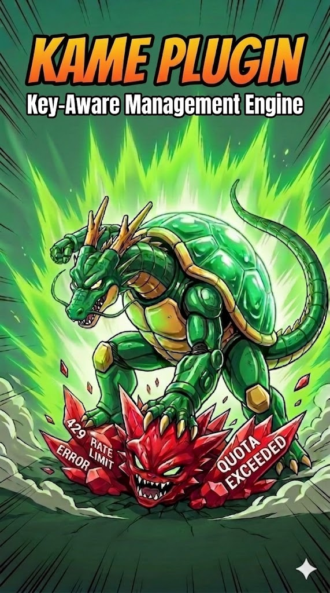
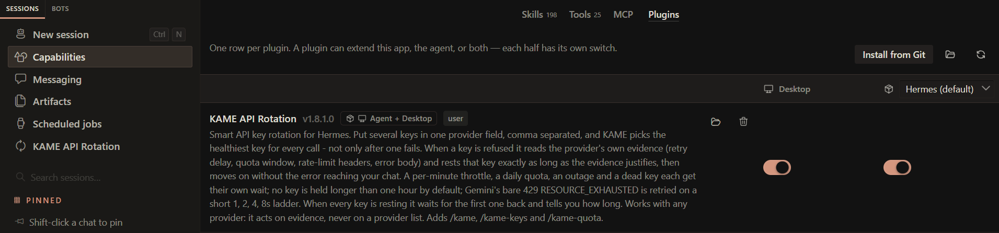
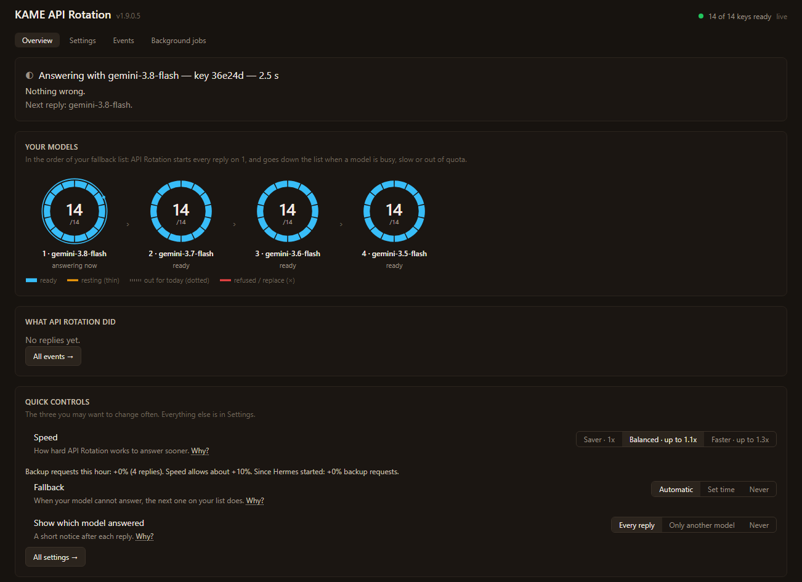
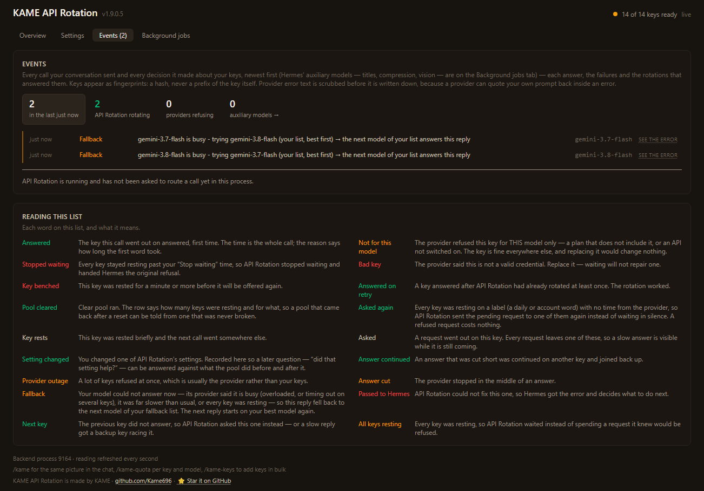
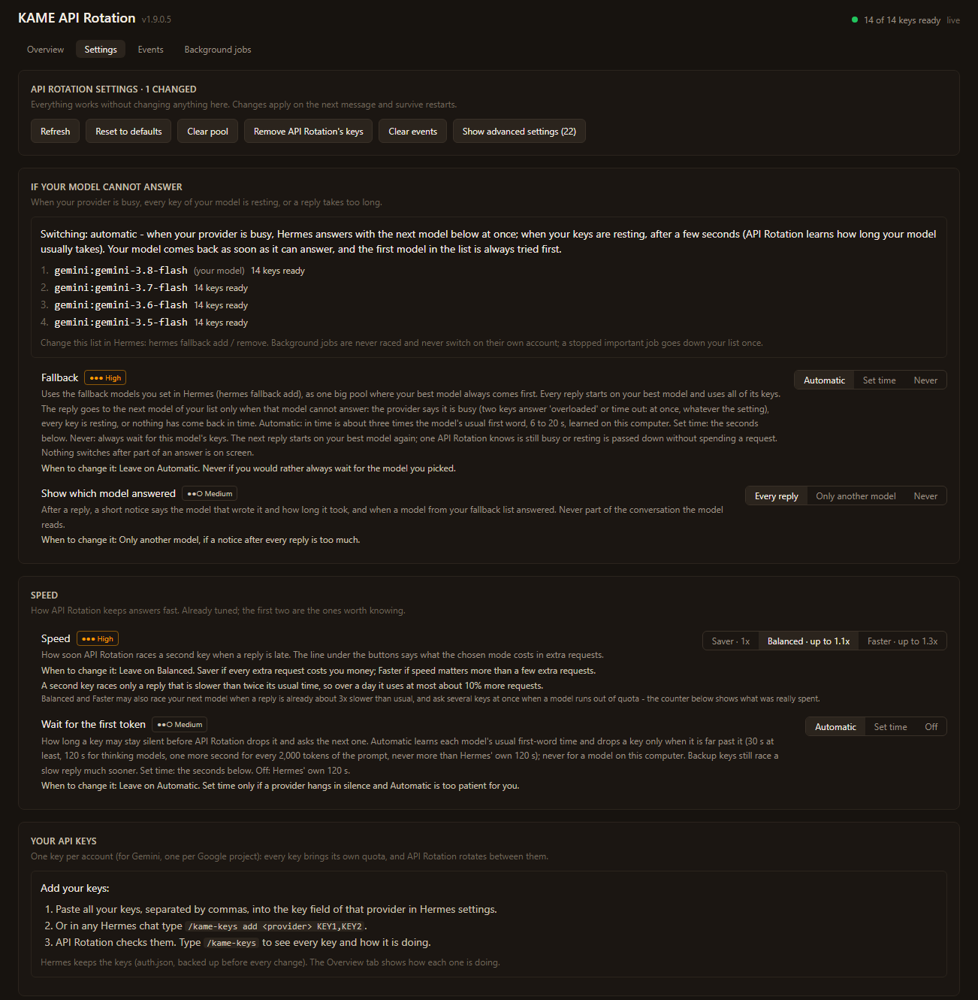
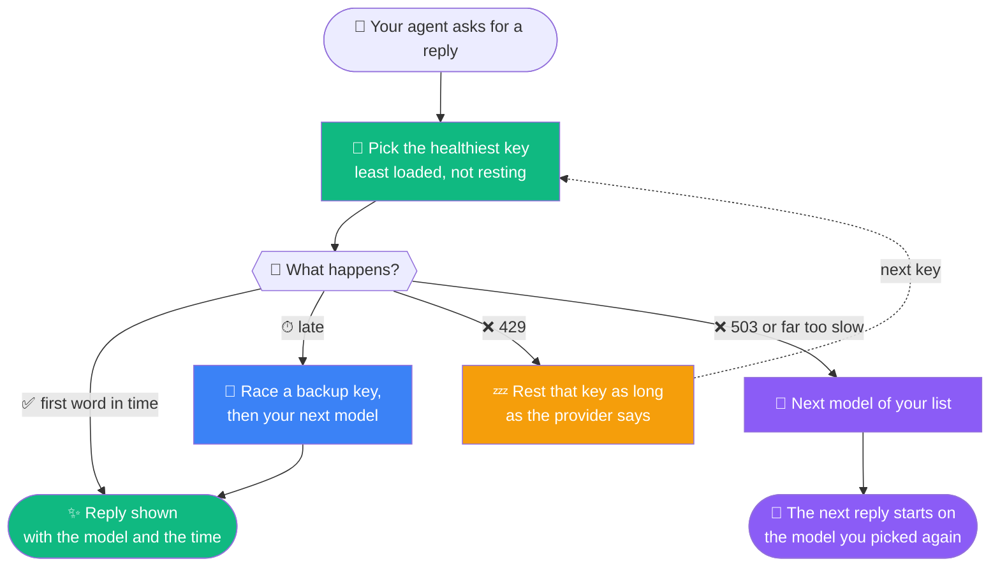

<div align="center">



# 🐢⚡ KAME — free API key rotation for Hermes Agent

### All your API keys and models as one pool. A `429`, a spent quota or a slow model never stops your agent again.

[](CHANGELOG.md)
[](#verified)
[](#verified)
[](https://github.com/NousResearch/hermes-agent/pull/146460)
[](LICENSE)
[](https://github.com/Kame696/kame-api-rotation-for-hermes/stargazers)

**Free and open source** · Gemini, OpenRouter, OpenAI, Anthropic, NVIDIA, DeepSeek and any other provider · made by **[KAME](https://github.com/Kame696)**

**[⚡ Install](#install-fast) · [🖥️ Screenshots](#screens) · [🔬 How it works](#how) · [❓ FAQ](#faq) · [Agent Zero version →](https://github.com/Kame696/kame-api-rotation-for-agent-zero)**

</div>

---

## 🎯 Two jobs in one plugin

Most key rotators only do the first one.

<table>
<tr>
<td width="50%" valign="top">

### 🔁 Rotation — more quota
All your keys, projects and accounts become **one pool** (14 Gemini projects = 14× the free quota). A `429`, a daily quota or a dead key moves the call to the **next healthy key at once**, and the refused key rests **exactly as long as the provider says**.

</td>
<td width="50%" valign="top">

### ⚡ Racing — less waiting
A reply that is **late**, **stops mid-thought** or **goes silent half-way** is sent again to another key or your **next model**. The first to answer is shown, the rest is cut. Extra requests only when a reply is stuck.

</td>
</tr>
</table>

Also: 🔀 **your model leads** — every reply starts on the model you picked; your fallback list takes over only when it is busy, spent or slow · 🧠 **reads every error** — 82 providers learned from their own docs · 👀 **you see everything** — which model answered each reply, and how long it took.

<a id="vs"></a>
## 🆚 KAME vs round-robin

Most key rotators cycle keys in order and retry on a timer. KAME decides from the refusal itself.

| | Round-robin rotator | **KAME** |
|---|---|---|
| Which key is next | the next one in the list | **the least-loaded healthy key** (60-second window) |
| After a 429 | retry on a fixed backoff | **the provider's own `retryDelay` / `Retry-After`, to the second** |
| Per-minute vs daily quota | same treatment | **told apart** (`quotaId`, reset headers, the pool's own behaviour) |
| Gemini bare `RESOURCE_EXHAUSTED` | fixed backoff or hammering | **1 → 2 → 4 → 8s … ladder, reset the moment the key answers** |
| Outage (5xx) | punishes every key | **1s, never escalates** — the key was never at fault |
| A key spent on one model | benched everywhere | **still used on your other models** |
| All keys resting | error, turn over | **waits for the first one back, and says so** |
| Longest a healthy key can be lost | whatever the provider claimed | **1 hour** (`max_hold_seconds`) |

<a id="install-fast"></a>
## ⚡ Install in 1 minute

<table>
<tr>
<td width="33%" valign="top">

### 1️⃣ Install

In the Hermes app open **Capabilities -> Plugins** and press **Install** on **API Rotation** (that also turns on its status bar and panel). One plugin, nothing else to add.

On the command line: `hermes plugins install Kame696/kame-api-rotation-for-hermes/hermes-kame-api-rotation`.

</td>
<td width="33%" valign="top">

### 2️⃣ Enable + restart

```bash
hermes plugins enable hermes-kame-api-rotation
```

Then restart Hermes once. (The Install button in the app enables it for you.)

</td>
<td width="33%" valign="top">

### 3️⃣ Add your keys

Where your provider's key already is, put **all your keys in that one field, separated by commas**:

`key1,key2,key3`

No command needed (details below the table). Everything else is **automatic**.

</td>
</tr>
</table>

> **🔑 All your keys in one field, no command**
>
> 1. Open the place where you already set your provider's API key: the Hermes dashboard, or the file `~/.hermes/.env`.
> 2. **Delete the key that is there** and paste **all your keys for that provider, separated by commas**, in that same field.
> 3. Save and restart Hermes once. Do the same for every provider you use.
>
> ```
> GOOGLE_API_KEY=AIza...key1,AIza...key2,AIza...key3
> OPENROUTER_API_KEY=sk-or-...key1,sk-or-...key2
> ```
>
> KAME turns that one line into one pooled key each, by itself. Prefer the chat? `/kame-keys add gemini KEY1,KEY2,KEY3` does the same.

> **🖥️ Optional: the KAME page in the left menu**
>
> Hermes Desktop keeps it off until you turn it on: open **Capabilities → Plugins**, find **KAME API Rotation** and switch on **Desktop**. **KAME API Rotation** then appears in the **left menu**, with the status chip in the bar. Rotation works without it.
>
> 

<sub>Prefer the command line? <code>hermes plugins install Kame696/kame-api-rotation-for-hermes/hermes-kame-api-rotation</code>. Every step in detail just below.</sub>

<details>
<summary><b>Step by step — command line, keys, the Desktop panel</b></summary>
<a id="install"></a>

### Install from the command line

```bash
hermes plugins install Kame696/kame-api-rotation-for-hermes/hermes-kame-api-rotation
hermes plugins enable hermes-kame-api-rotation
```

One plugin does everything: the rotation, the commands, the panel and the status-bar chip. A `hermes-kame-provider` left from 1.9.0.4 or older can be removed.

Then **restart Hermes** once. For the Desktop panel and the status-bar chip, turn on **KAME API Rotation** in Desktop **Settings → Plugins** (the panel ships inside the package at `desktop/plugin.js`; Desktop keeps it off until you say so — [step by step, with a screenshot](#panel)).

| | |
|---|---|
| **Needs** | Hermes 0.21.4 or newer, and nothing else — no third-party package |
| **Works without the Desktop** | yes; rotation is CLI- and gateway-safe, the panel is extra |
| **Turn it off without uninstalling** | `KAME_ROTATION_DISABLED=1`, or the first switch in the panel |
<a id="keys"></a>

### Add your keys

Paste them into **one** provider field, separated by commas — in the dashboard or in `~/.hermes/.env`:

```
GOOGLE_API_KEY=AIzaSy...aaa,AIzaSy...bbb,AIzaSy...ccc
```

That is all KAME needs. One key works too: a stalled reply is asked again on it and a busy model hands the reply to your next one; more keys add rotation.

KAME keeps such a list as one pool entry per key on its own, at every start, and follows the variable when you edit it (turn off with `resolver_disabled`). It writes through Hermes' own pool API, suppresses the comma source, backs up `auth.json` first, and never rewrites `.env`. `/kame-keys split` does the same once by hand.

<details>
<summary><b>Bulk import from any chat, including the Android app</b></summary>

```
/kame-keys add AIza...,AIza...,AIza...
/kame-keys add openrouter sk-or-...,sk-or-...
/kame-keys import ~/keys.txt
/kame-keys                       show pooled keys and their health
/kame-keys reset                 clear exhaustion, re-enable every key
```

Commas, spaces, newlines, semicolons and pipes all separate keys. Keys already pooled are skipped. A key is never echoed back — every message shows it as `AIzaSy…q7R8`. Pasting keys into a chat puts them in that chat's transcript; `import <file>` avoids that.

`add`, `import` and `split` write the new keys to `~/.hermes/auth.json` (Hermes' own credential store). Before each write KAME saves a plaintext copy of the previous file beside it as `auth.json.kame-<timestamp>.bak`, keeping the last 5 — those backups hold your keys in plain text, like `auth.json` itself.
</details>
<a id="panel"></a>

### Turn on the panel (optional)

Rotation works as soon as your keys are in. The Desktop panel and the sidebar entry are extra, and Desktop keeps them **off until you turn them on**:

1. In Hermes Desktop open **Capabilities → Plugins**.
2. Find **KAME API Rotation** and switch on **Desktop** (the *Agent* switch is the rotation itself).
3. **KAME API Rotation** appears in the left sidebar, with the status chip in the bar.

<p align="center"></p>

</details>

<a id="screens"></a>
## 🖥️ What you see

**The status-bar chip**, always on screen — the pool being called first. Hover for one line; **click** it for a
popover with the state in one sentence, your models, the last five replies and a button to the full page:

```
●  KAME  gemini:gemini-3.8-flash 11/14 4s   openrouter:deepseek/deepseek-v4 3/3
```

**The in-chat line** above the Desktop message box while a call waits or is being continued — `⏳ waiting on gemini:gemini-3.8-flash — KAME 13/15 keys healthy`. (CLI, TUI and gateway clients have no plugin channel for it; the chip, `/kame` and `/kame-quota` show the same state.)

**The panel** (`/kame`, or *KAME API Rotation* in the sidebar) — **POOL HEALTH** per provider and model, what each key is doing, every decision and where its number came from:

<p align="center"></p>

<details>
<summary><b>Events — every rotation, and where each wait came from</b></summary>

<p align="center"></p>
</details>

<details>
<summary><b>Settings — three labelled shelves, live, no restart</b></summary>

<p align="center"></p>
</details>

<sub>Rendered from the plugin's own panel code with sample data. Keys appear only as fingerprints, so every screen is safe to share.</sub>

<a id="how"></a>
## 🔬 How it works



<table>
<tr><th>Step</th><th>What KAME does</th></tr>
<tr><td>🔑 Pick</td><td>The key with the fewest requests in the last 60 s; a key is marked busy the moment it is handed out, so parallel agents spread across keys.</td></tr>
<tr><td>🏁 Race</td><td>Silent at about 2× the usual first word: a backup key of the same model. The fastest model of your list that is not failing also gets it: at its own usual first word when it is faster than the first model, otherwise at about 3×. A reply that thinks and then goes quiet is asked again; one that stops half-way is continued. First to answer wins.</td></tr>
<tr><td>💤 Rest</td><td>Exactly as long as the provider says, never more than an hour. A spent key still works on your other models.</td></tr>
<tr><td>🔀 Fallback</td><td>Your Hermes fallback list (`hermes fallback add`). Only models <b>you</b> listed, never after part of the reply is on screen, for any model a reply starts on (that model, then your main model, then the rest of the list), and every new reply starts on the model you picked.</td></tr>
</table>

<a id="privacy"></a>
## 🔒 Privacy

- **KAME never prints, logs or sends a key.** Screens and files carry fingerprints and counts only.
- **No telemetry, no network call of its own, no third-party package.**
- **It asks Hermes for no special permission** — no tool override, no model override, nothing to grant.
- Its local logs (`refusals.jsonl`, `calls.jsonl`) hold provider refusals and timings with keys redacted, and each can be switched off.

<a id="faq"></a>
## ❓ FAQ

<details>
<summary><b>Is it free?</b></summary>

Yes, completely: MIT license, no account, no telemetry, nothing to upsell. You keep paying only your provider, as before — and it works on free tiers such as Gemini's.
</details>

<details>
<summary><b>Does it work with OpenAI, Anthropic, OpenRouter — not just Gemini?</b></summary>

Yes. KAME decides from the refusal — retry timing, rate-limit headers, the shape of the error body — never from who the provider is.

The whole carousel runs inside the call on every API-key wire: chat completions (Gemini, OpenRouter, NVIDIA, DeepSeek, custom OpenAI-compatible endpoints and the rest), the Responses API (`api.openai.com`, xAI) and Anthropic Messages (Anthropic, MiniMax, Kimi coding). Least-loaded key first, waits, continuation of a cut answer (except on the Responses API, as in 1.8.1.8). Anthropic Messages needs a Hermes that offers `create_messages_client`; an older one builds its own Messages client, and KAME still sizes every refusal there.
</details>

<details>
<summary><b>Why does Gemini say <code>RESOURCE_EXHAUSTED</code> on every key at once?</b></summary>

Gemini's quotas are per Google Cloud project, and a bare `429 RESOURCE_EXHAUSTED` with no `quotaId` and no `retryDelay` often arrives on many keys at the same moment and clears on all of them together — which points at a busy model rather than at your quota. KAME retries those keys on a short 1-2-4-8s ladder instead of benching them, and the first key that answers resets its own ladder.
</details>

<details>
<summary><b>A key was rested for an hour. Is that a bug?</b></summary>

Only a confirmed daily quota or an empty balance rests a key that long. A daily label alone buys a 5-minute re-probe; the hour applies once the whole pool has gone 20 minutes without a single answer. Nothing is ever held longer than `max_hold_seconds`.
</details>

<details>
<summary><b>Does KAME send extra requests to make replies faster?</b></summary>

Only when a reply is stuck. A reply silent for twice its model's usual wait gets one backup on another key (a third if it is still silent). A reply that thinks and then goes quiet is asked at most twice more (another key, or the same key when it is your only one, then your next model). An answer that goes silent half-way costs one continuation. The first that works wins and the others are cut. A subscription login (Anthropic, ChatGPT) is never asked twice. Racing stops by itself when rate limits appear; turn it off with `hedging_disabled`.
</details>

<details>
<summary><b>Do I need to restart Hermes?</b></summary>

Once, after installing. After that every setting — panel, `/kame set` or a `KAME_*` variable — applies on the next call.
</details>

<details>
<summary><b>I only have one key. Does KAME help?</b></summary>

Yes: the right wait for each error, stream continuation, the live countdown and the one-hour ceiling all apply. A reply that stops mid-thought is asked again on the same key, a 503 moves the reply to your next model at once, and an answer that goes silent half-way is continued.
</details>

<details>
<summary><b>How do I know it is actually running?</b></summary>

`/kame` and the panel header show a 12-character build fingerprint computed from the files on disk. If a part of the plugin is missing, the panel says so in the loudest line on the page.
</details>

<details>
<summary><b>How is KAME different from LiteLLM or another gateway?</b></summary>

A gateway is a server you run in front of your clients. KAME is a plugin inside the agent: nothing else to start, and it knows the model you picked, your fallback list and the reply already on screen — so it can race a slow reply, which no gateway we searched does. Gateways are ahead on cost tracking and on serving any client. The full comparison is under [More details](#gateways).
</details>

---

## 📚 More details

Optional reading — everything above is all you need. Click a line to open it.

<a id="fast"></a>
<details>
<summary><b>🏎️ How fast? Measured live</b></summary>

On the author's own Gemini free-tier keys (four models of one provider × 14 keys), November 2026:

| Situation | What happens |
|---|---|
| Your **two best models overloaded** (503) | the next model answers: first sign of work **2.7 s** median, none over 20 s (10 live replies) |
| A 503 storm, **Hermes alone** | no answer in 200 s; **with KAME, 14–20 s** |
| A model **stops mid-thought** | asked again on another key once it is quiet past its own limit (8–20 s), then on your next model or provider |
| An answer **goes silent half-way** | continued after 45 s, where it could sit for minutes before |
| A key **out of quota** | the next key or model at once; the spent key still works on your other models |

<sub>Live numbers from the author's install; the rows without a number are rules, each tested in the plugin's suite. See <a href="VALIDATION.md">validation and limits</a>.</sub>

</details>

<a id="gateways"></a>
<details>
<summary><b>🧭 KAME and the big gateways</b></summary>

LiteLLM, CLIProxyAPI, new-api, Portkey and Bifrost are **gateways**: a server you run, which any client then
calls through one URL. KAME is a **plugin**: it lives inside Hermes, so there is nothing else to start, and it
sees what only the agent sees — the model you picked, your fallback list, the reply already on screen.

| | Gateways | **KAME** |
|---|---|---|
| Runs inside the agent, nothing else to start | no | **yes** |
| Tells throttle, daily quota, outage, dead key and no credit apart | partly (cooldowns in LiteLLM and Mirrowel's key proxy) | **yes, 82 providers mapped from their own docs** |
| Waits the provider's own retry time | yes in CLIProxyAPI, LiteLLM and new-api | **yes** |
| Races a second key when the first word is late | none found by a search of their code (Nov 2026) | **yes** |
| Tokens and cost per key | **yes** | no |
| Any client, through one URL | **yes** | no: Agent Zero and Hermes only |

<sub>Where they are ahead, the table says so. Searched in the public repositories of LiteLLM, Bifrost, Portkey,
CLIProxyAPI, new-api and Mirrowel's LLM-API-Key-Proxy in November 2026; "none found" means the search found none, not
that none can exist.</sub>

</details>

<a id="errors"></a>
<details>
<summary><b>🧠 How KAME reads every error</b></summary>

Every refusal is sized from what the provider actually sent. Decisions are made on the payload, never on the provider's name, so a provider that did not exist when this was written is covered by the same rules.

| The provider says | KAME does |
|---|---|
| **429 with a stated wait** (`retryDelay`, `Retry-After`, a reset header or time) | rests that key **exactly that long**, up to the 1-hour ceiling |
| **Gemini `429 RESOURCE_EXHAUSTED`, no number at all** | rests it **1s, then 2, 4, 8, 16, 32, 64s** on each repeat; back to 1s the moment it answers |
| **Any other throttle with no number** | a short flat rest, **20–30s** — measured: retried within 30s, a refused key answered 0 of 73 times |
| **A daily quota** (e.g. `PerDay` in `quotaId`) | re-probes in **5 minutes** while other keys still answer; rests **1 hour** once the whole pool has been silent for 20 minutes |
| **An account-wide limit** (a subscription cap) | benches that credential on **every model** of the provider, up to the ceiling |
| **Out of credit** | **1 hour** — a person has to top it up |
| **5xx / overloaded** | **1 second**, never escalates — an outage is not the key's fault |
| **Timeout / dropped connection** | moves to the next key; the key is not rested at all |
| **Bare 401** | 20s, offered last, out of rotation after 3 in a row |
| **"This key is invalid / revoked"** | out of rotation at once — replace it and it comes back by itself |
| **403 for one model only** | that key skips that model and keeps working on the others |
| **An answer cut mid-stream** | continued on another key and joined back into one reply |
| **Anything it cannot size** | left to Hermes' own classifier, unchanged |

</details>

<a id="settings"></a>
<details>
<summary><b>⚙️ Settings</b></summary>

Nothing needs changing. Every setting is in Desktop **Settings ▸ Plugins ▸ KAME API Rotation**, in `/kame set`, and as an environment variable. When the same setting is set in more than one place, the environment variable wins.


| Setting | Default | What it does |
|---|---|---|
| `max_hold_seconds` | `3600` | No key sits out longer than this, whatever caused the hold |
| `max_total_wait_seconds` | unset | *Give up after* (advanced). Unset: a chat waits for as long as it takes, and a cron run stops after 300 s with the provider's refusal. Set it to `0` for no bound anywhere, or to a number to bound both |
| `unsized_throttle_backoff` | on | The 1-2-4-8s ladder for Gemini's bare `RESOURCE_EXHAUSTED` |
| `unsized_backoff_max_seconds` | `64` | Where that ladder stops growing |
| `unsized_throttle_rest_seconds` | `30` | Rest after any other throttle that names no wait |
| `daily_quota_cooldown_seconds` | `3600` | Rest once a daily quota is confirmed by a silent pool |
| `model_switch` | `auto` | *Fallback*. With a fallback list in Hermes, one pool with your best model first: a reply falls back to the next model at once when your provider is busy, at once when every key is resting, otherwise after about three times your model's usual first-word time (6–20 s, learned); every reply starts on your best model again. `timed` ("Set time") uses the number below; `never` waits for your keys |
| `failover_after_seconds` | `60` | *Fallback after*. With `model_switch: timed`: seconds a reply waits with nothing on screen before it falls back to the next model |
| `reply_notice` | `always` | After each reply, a Desktop notice naming the model and its time; `switches` only when a fallback model answered; `never` |
| `never_fall_back_to_another_model` | off | On: ignore your Hermes fallback list and always wait for your keys |
| `share_pool_health` | on | Several Hermes profiles with the same keys share one health file |
| `stream_resume_limit` | `-1` (automatic) | Continue while new answer content arrives; `0` disables recovery, `1`–`10` set an explicit ceiling |
| `first_token_wait` | `auto` | Wait for the first token: `auto` drops a key that stays silent far past its model's usual first word (20–120 s, 60–300 s for thinking models; streams only; never a local model); `timed` uses the number below; `off` |
| `stream_silence_timeout_seconds` | `0` | With `first_token_wait: timed`: seconds a key may stay silent |
| `hedging_disabled` | off | Stop backup requests everywhere (chat and background calls) |
| `hedge_mode` | `adaptive` | Speed — Saver · 1x (`off`) one request per reply; Balanced · up to 1.1x (`adaptive`) races a second key only when a reply is late; Faster · up to 1.3x (`max`) races a little sooner and more often, and steps back to Balanced for 10 minutes when a key hits a rate limit. The multipliers follow `hedge_budget_pct` |
| `hedge_budget_pct` | `10` | Long-run ceiling on extra requests, as a share of calls |
| `hedge_max_legs` | `3` | 1 = no backups, 2 = one backup, 3 = a chat reply still silent may try a third key |
| `probe_burst_max_legs` | `16` | When quota runs dry, at most this many keys asked at once (`0` = one by one) |
| `disabled` | off | Turn KAME off without uninstalling (`KAME_ROTATION_DISABLED=1`) |

The panel explains every one of them in full, with its environment variable.

</details>

<a id="commands"></a>
<details>
<summary><b>💬 Commands</b></summary>

| Command | What it answers |
|---|---|
| `/kame` | Pool health, this process's counters, what is resting and until when, and the build fingerprint |
| `/kame doctor` | Is it rotating correctly? Every kind of refusal beside the rest it got, and anything only a person can fix |
| `/kame get` · `/kame set <key> <value>` · `/kame reset <key>` | Read and change settings, live |
| `/kame events` | The latest rotations, rests and cut streams |
| `/kame-quota` | The quota picture per key and per model |
| `/kame-keys` | Add and inspect pooled keys in bulk; `split` gives each key of a comma list its own pool entry |

</details>

<a id="verified"></a>
<details>
<summary><b>✅ Verified — tests and live checks</b></summary>

**1.9.0.4** (2026-11-19), see the [changelog](CHANGELOG.md):

| Check | Result |
|---|---|
| Plugin suite (1.9.0.4) | **0 failing**, 4,415 passing (two timing tests that are slow only under load passed alone) |
| Live (1.9.0.4) | On a list whose first model thinks for ~22 s: the race asked the model that answers in ~6 s at 6.6 s and a second one at 12.6 s (1.9.0.3 asked a model that had not answered in ten days at 31 s); a model that keeps failing was left out; first-word times seeded from the call log and kept across Reset pool; Stop, Reset pool, Gemini and NVIDIA replies, chat titles; KAME's idle threads at 1.6% of one core; four Hermes profiles |

**1.9.0.3** (2026-11-18):

| Check | Result |
|---|---|
| Plugin suite (1.9.0.3) | **0 failing**, 4,371 passing (one timing test that is slow only under load passed alone) |
| Live (1.9.0.3) | Stop and Reset pool through the gateway; Gemini and NVIDIA replies; a request the provider refused (HTTP 410) shows the provider's own text in its row; transcription moved to the next Gemini model of the list when every key of the voice model was resting; chat titles made; KAME's idle threads at 1.3% of one core; four Hermes profiles, the daily live check in each |

**1.9.0.2** (2026-11-16):

| Check | Result |
|---|---|
| Plugin suite (1.9.0.2) | **0 failing**, 4,315 passing (one timing test that is slow only under load passed three times alone) |
| Live (1.9.0.2) | Stop through the gateway ends the rotation; Reset pool clears Hermes' own marks; a reply with the best model failing started on the healthy model while the model due a second look was asked beside it from the first instant; Gemini and NVIDIA keys checked; four Hermes profiles, the daily live check in each |

**1.9.0.1** (2026-11-14):

| Check | Result |
|---|---|
| Plugin suite | **0 failing**, 4,225 passing, including a matrix of user situations (a list with a second provider, one key, no list, "Never switch"; a reply that is silent, that stops mid-thought, that stops mid-answer, that meets a 503) |
| Host gates | `host_prose` ok; `host_assumptions` ok; `host_corpus` on the installed Hermes: only the verdicts KAME changes on purpose; Hermes' own provider and credential suites on v0.23.0 answer the same with KAME's client |
| Fault injection | 5,000 calls with random refusals, cuts and timeouts (`tools/chaos.py`), 150 raced replies in seven kinds of setup (`tools/race_chaos.py`): 0 defects; with the mid-thought hand-over removed it reports the reply left waiting |
| Live, a failing provider | 2026-11-14 11:18-11:31: one model timing out on every key, one answering 503, two out of their daily quota on most keys; every reply sent through the gateway was answered, each on the first model that could |
| Installed | four Hermes profiles, the daily live check 13 of 13 in each |

<details>
<summary><b>Earlier versions (click to open)</b></summary>

**1.9.0.0** (2026-11-14), see the [changelog](CHANGELOG.md):

| Check | Result |
|---|---|
| Plugin suite | **0 failing**, 4,143 passing |
| Host gates | `host_prose` ok; `host_assumptions` ok; `host_corpus` on the installed Hermes: only the verdicts KAME changes on purpose; Hermes' own provider and credential suites on v0.23.0 answer the same with KAME's client |
| Fault injection | 5,000 calls with random refusals, cuts and timeouts (`tools/chaos.py`) and 150 raced replies whose winner thinks and then hangs (`tools/race_chaos.py`): 0 defects |
| Live, thoughts | reasoning on screen 0.4 s after the request, before any text; a reply forced to look quiet after 0.5 s asked both rescues and answered, with no refused follow-up request |
| Live, a model left out | after an outage had left the fastest model out, the next replies looked at it again and started on it (1.8.4.2 had sent every reply to the slowest model, 10 to 19 s to a first sign) |
| Live, a slow provider | 2026-11-14 02:33-02:41, every Gemini model of the list slow at once (first sign 51 to 104 s, 503s): the replies answered, each on the model that spoke first; no rotation is faster than the fastest model of the list |
| Installed | four Hermes profiles, the daily live check passing in each (13 of 13), real replies through the gateway |

**1.8.4.2** (2026-11-11), see the [changelog](CHANGELOG.md):

| Check | Result |
|---|---|
| Plugin suite | **0 failing**, 4,034 passing |
| Host gates | `host_prose` ok; `host_assumptions` ok; `host_corpus` on the installed Hermes: 200 of 200 alone, 196 of 200 with KAME (the verdicts KAME changes on purpose); Hermes' own provider and credential suites on the installed Hermes and on v0.23.1 answer the same with KAME's client (56 clients built) |
| Live, main model failing | first reply after a restart: first text in 2.9 s on the next model, with no wait for a key, while the main model was asked beside it (1.8.4.1: about 20 s waiting on it first) |
| Live voice | a spoken Portuguese question transcribed word for word (18 of 18) on the Gemini keys; a voice turn through the gateway: first token in 7.6 s, 3.0 s of it the model |
| Fault injection | random refusals, cuts and timeouts (`tools/chaos.py`) and 150 raced replies (`tools/race_chaos.py`): 0 defects |
| Installed | four Hermes profiles, the daily live check passing in each |

**1.8.4.1** (2026-11-10):

| Check | Result |
|---|---|
| Plugin suite | **0 failing**, 3,910 passing, 4 expected failures |
| Host gates | `host_prose` ok; `host_assumptions` ok, and it now fails if Hermes adds a safety wording KAME does not know; `host_corpus` on Hermes v0.23.0 and v0.23.1: 200 of 200 alone, 196 of 200 with KAME (the verdicts KAME changes on purpose); Hermes' own provider and credential suites on v0.23.1 answer the same with KAME's client (56 clients built) |
| Live on Hermes v0.23.0 | real replies with real 503s on the main model: answered in 14 to 20 s; Hermes alone gave no answer in 200 s |
| Fault injection | 5,000 calls with random refusals, cuts and timeouts (`tools/chaos.py`) and 300 raced replies, some of them repeating text (`tools/race_chaos.py`): 0 defects |
| Installed | four Hermes profiles, the daily live check passing in each, real replies through the gateway |

**1.8.3.0** (2026-10-29):

| Check | Result |
|---|---|
| Plugin suite | **3,543 passing** in the development tree, 342 skipped, 1 failing that reads the author's own recorded evidence and fails the same way on 1.8.2.9 |
| Host gates | `host_prose` ok; `host_corpus` on a copy of the real Hermes: 200 of 200 alone, 196 of 200 with KAME = the same 4 intentional verdicts as 1.8.2.9, nothing new; `host_assumptions` unchanged |
| Fallback only for the main model | a reply that started on another model never uses the list; a reply Hermes walks down the list keeps its permission (25 checks) |
| Selector stays on the main model | a same-provider fallback answers inside KAME with no hand-over; the page sets the main model back for that conversation only (21 checks, run in node) |
| Request errors | four recorded NVIDIA "unsupported parameter" 400s are handed back after the first key with no rest; a 402 reads as a spent account |
| Logs | rotation checked through the real writers (current + one previous generation, first-word history across both) |

**1.8.2.9** (2026-10-24), see the [changelog](CHANGELOG.md):

| Check | Result |
|---|---|
| Plugin suite | **3,472 passing** in the development tree. Run from this repository, 19 tests fail because they read research data that is not published here (provider answer keys, build contracts); they fail the same way on 1.8.2.8 |
| `hermes plugins doctor` | **pass** for `hermes-kame-api-rotation` and `hermes-kame-bridge` on a stock Hermes |
| Host gates | `host_prose` ok; `host_corpus` on a copy of the real Hermes: 200 of 200 alone, 196 of 200 with KAME = the 4 intentional verdicts only; `host_assumptions` unchanged |
| Installed copy | four Hermes profiles, same build fingerprint, `live_daily` passes; real replies answered with the newest Gemini models busy |
| Idle CPU of the plugin's four heartbeats in one gateway | about 30% → about 6% of one core, measured per thread on the running process |
| Healthy reply speed vs 1.8.2.8 | within noise (alternating runs); the gains are in busy hours, not on a healthy reply |
| Side job budget | a title that made 167 attempts in 12 minutes now stops at 3 requests in 30 s (replayed from the recorded state) |

**1.8.2.8** (2026-10-17), see the [changelog](CHANGELOG.md):

| Check | Result |
|---|---|
| Plugin suite | **3285 passing**, 0 failing (the two load-sensitive gate tests pass alone) |
| The owner's case, end to end | a model answering 503 "overloaded" on two keys hands the call to the next model of the list after those two requests, not after the whole pool; without a list the keys keep rotating one at a time |
| Host assumptions | Hermes still reads the hand-over's `reset_at` as the cooldown and its retry backoff never does (4/4) |
| Expected-decision gate (real recorded traffic) | family agreement 99.76 %, unchanged |
| Live on the author's base profile, real Gemini free-tier keys, 4 fallback models × 14 keys (2026-10-18) | healthy first model: every reply on it, first word 2–4 s; first model out of quota: handed over in 0.2–0.3 s, reply in 6–7 s, and the next reply after it is back is its own again; first model slow (gemini-3.8-flash 1 m 46 s – 2 m 18 s for one word on every key, the next one 14–47 s): median reply **2.6 s** over 8 messages (7 of 8 at 2.2–2.8 s), was 46–120 s; a 503 "overloaded" storm: handed over in 6.3 s, answered at 8.3 s (1.8.2.7 never moved); no "⚠️ Model fallback" line in any reply |

**1.8.2.7** (2026-10-17):

| Check | Result |
|---|---|
| Plugin suite | **3,196 passing**, 0 failing |
| Provider answer keys | 82 providers, 774 documented error shapes; regression floors in the suite |
| Fallback list, live (Gemini 3.8 → 3.7 → 3.6 → 3.5 → 3, 14 keys each, real keys) | one spent model: switched in 0.2 s; four spent: all skipped in 0.2 s, the fifth answered; keys back: the first model answered again |
| Dry pool, real refusal timings | first turn 58 → 27 s, hourly re-check 59 → 13 s, every next turn one request |
| Two independent adversarial reviews | every finding fixed and pinned by a test |
| Installed copies | four Hermes profiles, same build fingerprint, `live_daily` 13/13 on each |

**1.8.2.5** (2026-10-12), see [BUILD-1.8.2.5-CONTRACT.md](BUILD-1.8.2.5-CONTRACT.md):

| Check | Result |
|---|---|
| Plugin suite | **3,067 passing** (the two load-sensitive gate tests pass alone) |
| Stream race tests | 27, real threads, incl. the Anthropic Messages wire; stable over repeated runs |
| Concurrency stress | 1,080 streamed calls on 12 threads with slow, empty, 429, 503 and cut replies: no internal error, no thread left behind |
| Real keys, Gemini (14 keys) | alternating raced / unraced replies: worst first word 7.4 s vs 33.0 s (forced triggers), 16.5 s vs 27.1 s (learned) |
| Real keys, NVIDIA (2 keys) | thinking replies are not raced; no slowdown |
| Installed copies | three Hermes profiles, same build fingerprint, `live_daily` 13/13 on each |

The section below is the 1.8.2.2 certification on a Hermes copy.

1.8.2.2, on a copy of Hermes `56f7986` (main of 2026-10-05). Local fake
providers, except the real-key row. Details in [VALIDATION.md](VALIDATION.md).

| Check | Result |
|---|---|
| `hermes plugins validate` (the two catalog packages) | **pass**, `no core override` and `desktop surface` included |
| Real Hermes turns vs 1.8.1.8, six scenarios × four wires | **every turn answered** on native Gemini, OpenAI chat and Responses, with faster steady turns. On the Anthropic Messages wire this needs `create_messages_client` (#133461 or the optional bridge); with it, every turn is answered |
| Status line on the spinner | present with #133474 or the optional bridge. Otherwise it appears above the Desktop composer |
| Real keys (NVIDIA, 2 keys) | 3 of 3 turns answered. One empty answer was rotated to the next key, and the live line showed on the spinner |
| Plugin suite | **2,851 passing** on Hermes `56f7986`, and on Hermes with each upstream seam applied |
| Host gates (classifier corpus, prose) | **pass**, with the corpus keeping its five documented intentional differences |

### Historical validation (not a new-build certification)

1.8.1.6 was installed in the author's running Hermes 0.21.3 gateway (all
three profiles): real agent turns on Gemini 3.8 and NVIDIA Kimi K3 answered
16 of 16, and a replay of 2,634 recorded refusals through 1.8.1.2 and 1.8.1.6
changed no decision. 1.8.1.2 was validated on the running Hermes gateway with real agent turns on
Gemini 3.8 and NVIDIA Kimi K3 across a real daily-quota wall and reset, with a
separate probe measuring how Gemini's per-minute and per-day limits behave.
Daily-traffic evidence and the 0.21.1 gate belong to earlier builds;
Agent Zero runtime validation remains separate. 1.8.1.3 re-ran every offline
host witness in `tools/` against Hermes 0.21.3, 0.21.4 and 0.21.5 installed
from their release tags; it changes no runtime behaviour, so the live-gateway
evidence above still describes what runs.

</details>

</details>

<a id="new"></a>
<details>
<summary><b>📣 What's new in 1.9.0.5</b></summary>

**1.9.0.5 — one package, Gemini rotated again, and the chat shows what API Rotation does.** From the owner's test.

- **One package.** `hermes-kame-provider` is no longer needed: API Rotation does its work alone. If you still
  have it, it keeps working, and `/kame` says once that it can be removed (`hermes plugins remove hermes-kame-provider`).
- **Gemini's own client is rotated again**, key by key (Hermes' own Gemini client for each key; nothing re-written).
- **A live sentence where you look.** The status bar chip says what API Rotation is doing right now (a key
  replaced, every key resting with the countdown, another model answering); in the TUI and in messaging apps one
  line in the conversation says the same and is updated in place. A clean reply posts nothing. Turn it off with
  `live_chat_line`.
- **Desktop notice.** If the app's status bar and panel are off, one line tells you where to turn API Rotation on
  (Capabilities -> Plugins).
- **Keys.** Pasted keys are checked (empty items dropped, a key that does not look like the provider's is named, a
  Gemini key the provider rejects is named). `/kame-keys remove-all` (panel button "Remove API Rotation's keys") takes
  API Rotation's keys out of Hermes so the plugin can be uninstalled cleanly.
- **"Everything failing until Reset" is gone.** While every key rests, API Rotation sends the waiting request to
  one resting key after 20 s (then 40, 80, 160, at most every 300 s), so a provider that is already healthy
  answers at once. A refusal that holds the whole account needs a second refusal from another model before it
  holds every model, unless the provider stated a deadline or the account is out of credit.
- **Reset says what it cleared** (keys held, longest hold left, kinds of holds).

**Add your keys, in three lines**

1. Paste all your keys, separated by commas, into the key field of that provider in Hermes settings.
2. Or in any Hermes chat type `/kame-keys add <provider> KEY1,KEY2`.
3. API Rotation checks them. Type `/kame-keys` to see every key and how it is doing.

</details>

<a id="new-1904"></a>
<details>
<summary><b>📣 What's new in 1.9.0.4</b></summary>

**1.9.0.4 — the race asks the model that answers, when it usually answers.** From the owner's test with a thinking
model first in his list.

- **The race picks by record, not by place.** A model of your list that keeps failing is left out of the race
  (it is still looked at again when its retest is due), and the model that usually answers fastest goes first,
  even when it is lower in your list.
- **It joins when that model usually answers.** With a slow thinking model first, the next model used to join at
  three times the slow model's own time (31 s in the owner's test); now it joins at its own usual first word
  (6.6 s in the same list), never later than before.
- **What KAME learns is kept.** Each model's time to first word is kept on disk (last 20, seven days) and read
  after a restart; on the first start it is learned from the plugin's own call log.
- **A raced model that fails is replaced at once** by another key of that model (once per reply), and its key's
  rest is written at the moment it failed.
- **What it costs:** with a first model that usually takes longer than a model below it, most replies send one
  more request, to that faster model of your list; its answer is the reply when it comes first. Saver turns the
  race off.

**1.9.0.3 — the screen says what happened, voice is not lost.** From the first installed days of 1.9.0.2.

- **Every failure row in the panel opens** and shows the provider's own text and the error type. A request the
  provider refused (a model at its end of life, a wrong name) says so: it is the request, not a key.
- **While the model is silent, the status row keeps saying so** every 5 s ("no first word yet"), with the backup
  key or the other model racing it.
- **The Speed line counts only the backup requests your Speed setting allows**, so it no longer reads as "your
  setting is ignored" when the extra requests came from the provider refusing.
- **"API Rotation" on screen** instead of "KAME"; "slow to start" and "overloaded" say what they mean.
- **Voice is not lost when the voice model's keys rest:** transcription tries the Gemini models of your list
  (with "Never switch", only the chosen model), and a failure is written in the log.
- **"Never switch" also keeps Hermes' background requests on your model** (the title fallback after 30 s).
- "stopped before it was sent" instead of "timed out after 0 tries"; the first-word wait help gives the real
  numbers; the README says the wake word is Hermes' own setting.

**1.9.0.2 — Stop stops, Reset works again, the wait is said.** Fixes only, from one installed week of 1.9.0.1.

- **Stop reaches the key rotation:** after Stop, at most the request already on the wire finishes.
- **Reset pool clears Hermes' own marks again**, and when a part of the reset fails it names which one and why.
- **Chat titles are made again**, and one silent key no longer loses the title.
- **A reply starts on the first model of your list that is not failing.** A model due a second look is asked
  beside it from the first instant: if it answers first, the reply is its own and it is trusted again.
- **Voice and transcription share the chat's memory of each key.**
- **The wait is said in the provider's words**, and when every key refused naming no time, the line says so.
- **Every call that ends without an answer leaves one closing row** in `calls.jsonl`.

**1.9.0.1 — a reply is never left waiting when something else could answer.**

- **A reply that stops mid-thought moves on to the next provider** of your Hermes list once the two extra requests
  have had their turn, instead of waiting for the provider's timeout. With no later entry, or "Never switch", it
  keeps waiting as before.
- **One key, or no list, still gets its extra request:** the same key asked again, or another key of the same model.
- **The only key busy is the model busy:** one 503 on your only key sends the reply to the next provider or model
  at once.
- **An answer that starts and then goes silent for 45 s is cut and continued** like a dropped one, nothing
  repeated. `KAME_ANSWER_QUIET_S` sets the limit (`0` turns it off).

**1.9.0.0 — thoughts stay live, a stalled reply is raced again, a busy model is raced at once.**

- **A thinking reply is watched until it shows something; its thoughts keep showing live.** A reply that stops
  mid-thought with nothing shown no longer leaves you on the spinner: KAME asks another key of the same model
  beside it and, later, the next model of your list. The first one to show text or a tool call is the answer. At
  most two extra requests per reply, and one only when a healthy model is quiet past its limit, as when it writes
  a very large tool call in one piece (Gemini); they are counted in "Extra requests", with how many answered
  first. The limit is learned for each model (8 to 20 s, longer for a model that is quiet by nature, never above
  90 s; 20 s before it has learned). `KAME_THOUGHT_QUIET_S` sets one limit for all (`0` turns it off).
- **A model that says it is busy is raced at once.** When your model answers 503 ("high demand", "overloaded"),
  the retry on the next key no longer runs alone for 8 to 12 s: the next model of your list is asked beside it
  from the first instant and the first to answer is shown. One extra request for a reply that met a 503, counted
  in "Extra requests".
- **A model left out is looked at again.** A model of your list left out after failing is a candidate again 10
  minutes later (twice as long after each further failure, at most 2 hours), so one outage no longer keeps your
  fastest model out for days. A best model that keeps failing is asked beside your replies less often (at most
  every 5 minutes), and leads again the moment it answers.
- **A background title on a model that keeps failing or is busy** goes at once to the next healthy model of your
  list on the same provider.
- **Two honest limits.** A reply that stalls after its text has started is not raced: the read timeout (up to
  120 s) ends it and another key continues the cut answer, as before. In six weeks of the owner's log that was
  about four events; the rows now carry what is needed to size a watch for it later. And when a provider refuses
  every model of your list at once, nothing in a one-provider list can answer: KAME keeps asking and shows the
  first that does, and a model of another provider at the end of your list is what answers in that minute.

**1.8.4.2 — a model that keeps failing stops making you wait.**

- **Your best model still leads, unless it keeps failing.** KAME remembers, across restarts, the last outcomes
  of each model. When your main model's latest outcome is a failure and it failed at least twice in its last ten
  tries (seven days), a reply no longer waits on it: it starts on the next model of your list, and your main
  model is asked beside it. If your main model answers first, the reply is its own; if it speaks again while the
  other one answers, the next reply starts on it. While your main model is healthy nothing changes and nothing
  extra is sent. `KAME_NO_REMEMBERED_TROUBLE=1` turns it off.
- **A model refused busy is not handed the same reply again**, and a background job stopped once no longer
  keeps the provider out of background tasks for ten minutes.
- **A background title skips a model that keeps failing**, instead of waiting on it.
- **Listening with your Gemini keys.** Set `stt.provider: kame-gemini` and Hermes transcribes your voice through
  your Gemini keys, rotated like the chat's. Off until you set it.
- **Speech language.** `tts.kame-gemini.language` (for example `pt-BR`) sets the language of the spoken reply.

**1.8.4.1 — a blocked prompt stops at once, one number on the screen.**

- **A prompt no key can answer stops at once.** A provider's safety refusal used to be read as a refused
  key: every key was tried and rested, and two wordings never stopped at all. Now it goes straight back and no
  key is punished. The same for Anthropic's "extra usage is required for long context", which only a shorter
  request can cure.
- **A reply soon after your model was busy does not wait for it to refuse again.** It starts on the next model
  of your list and asks yours beside it; whichever starts answering first is shown, yours included.
- **One number on the screen.** The header, the chip and the sentence give the same count.
- **What KAME did for you, over time.** `Since 12 Oct: 1,240 replies, 96 saved from a provider error.` Kept on
  your machine; it survives a restart and Clear pool.
- **Sent in the last 24 hours**, beside the provider's own daily limit when it states one. Display only.
- **A very short cut answer is no longer repeated** ("Hello Hello world").
- **Subscriptions are never raced.** A backup request goes out only on a plain API key; the rule reads the
  credential's type, never the provider.
- **Speech with your Gemini keys.** Set `tts.provider: kame-gemini` and Hermes speaks through your Gemini
  keys, rotated like the chat's: a refused key rests and the same sentence goes to the next one. Off until you
  set it.

**1.8.3.1 — any model has a way down, one live line, a popover on the chip.**

- **Any model has a ladder.** A reply that starts on model X falls back X, then your main model, then
  the rest of your list. Picking a model by hand no longer switches the help off. Never switch forbids
  every switch; background jobs are never raced and never switch on their own account (a stopped
  important job goes down your list once, as before); and nothing moves once part of the reply is on screen.
- **One live line, the same words in both versions.** Asking, trying another key, a backup key is asking
  too, another model is answering instead, every key is resting (and for how long), the answer is being
  continued, back after a rest.
- **A popover on the chip.** Click the status-bar chip for one sentence with the state colour, your models
  with their rings, the last five replies in plain sentences, and a button to the full page.
- **A busy model is noticed at the first knock** after a busy window, not the second.
- **Host limits, on record.** The circle back and the start probe stay on one provider in the Hermes port
  (Hermes' host owns the move to another); the model selector goes back to the model the reply started on.
  Hermes' own walk is your fallback list only and never goes to your main model, so when you pick a model
  of one provider and your main model is of another, the main model is reached only when KAME answers
  inside; a hand-over to Hermes walks your list. Hermes' own spinner keeps its old words (the Desktop
  erases a line it does not recognise), so the new live line is the one above the message box. The chip
  says "Ready - next reply: <main model>" even in a chat on a model you picked: the page cannot read the
  model of the conversation in view reliably.

**1.8.3.0 — the fallback list belongs to your main model, and the selector stays on it.**

- **Fallback only for your main model.** The list is used only for a reply that started on the model
  in your Hermes configuration. Pick another model for a conversation (or a model that is itself in
  your list) and that reply stays on it: no switching, no racing, no stand-in.
- **The main model stays on the selector.** When the next model of your list is on the same
  provider, KAME answers with it itself (the notice says "X answered for Y") and Hermes never
  switches, so the selector never moves. For a model of another provider Hermes still switches; the
  desktop page then sets your main model back on that conversation's selector when the reply
  ends. It never changes your default model. Hermes keeps its own backoff (60 s, doubling) before
  it returns to the main model by itself, and KAME cannot shorten that.
- **Request errors are not blamed on your keys.** A "400 unsupported parameter" goes back to Hermes
  after the first key and rests nothing; an NVIDIA "402 credits exhausted" rests the key for the long
  window.
- **The logs rotate.** `calls.jsonl` and `refusals.jsonl` keep the current file and one previous one
  instead of going silent at 4 MB / 8 MB.

**1.8.2.9 — back to your best model, a quiet gateway, side jobs on a budget, a rotation page you can read.**

- **Back to your best model.** When the model in use is busy and nothing after it in your fallback
  list is free, KAME goes back up the list, best first, one request at a time, asking a busy model
  again at most every 20 s. The busy best model is also asked *beside* the reply (never delaying
  it): if it answers first, it is shown.
- **No reply behind two silent models.** The wait behind a silent best model plus a silent next
  model is shorter (24 s instead of 34 s, 56 s instead of 79 s in the bench), one more model of
  your list joins at the slow bound, and when nothing else could answer, nothing is cut.
- **Background jobs get a budget.** One title once made 167 attempts in 12 minutes on the best
  model. A title now sends at most 3 requests in 30 s, other side jobs at most 6 requests or 5
  minutes, and a stopped job moves down *your* list through Hermes. Your chat keeps its wait.
- **Where your quota went.** The panel shows how much of each model's requests were side jobs and
  says in words which job you could move to which model of your list. KAME never edits your config.
- **Nothing idle burns your CPU.** The four plugin copies a gateway loads re-parsed `config.yaml`
  every few seconds: about 30% of a core with nothing happening, about 6% now.
- **Speed in plain words.** Saver · 1x, Balanced · up to 1.1x, Faster · up to 1.3x. *Faster*
  replaces *Fastest*, which doubled the requests of every reply and could use up a whole pool.
- **A rotation page you can read.** Three sentences, one ring per model with a segment per key,
  what KAME did, the three controls you reach for, *Wake this model* and *Try this model now*.
- **Works on a stock Hermes.** The fallback list is read with Hermes' own YAML reader, then
  PyYAML; the reviewer-found `import yaml` defect is gone.

A healthy reply is not faster than in 1.8.2.8 (measured: within noise). The gains are in the
bad hours: fewer wasted requests, shorter waits behind silent models, a quieter machine.

**1.8.2.8 — speed first: median reply 2.6 s live on a day the newest Gemini took 2 minutes per word.**

- **A busy provider no longer holds your agent.** Two keys in a row answering "the model is
  overloaded" (or timing out) mean the model is busy, not your keys: the reply falls back to
  the next model of your list at once. Before, a 503 rested each key one second, the "every
  key resting" clock never moved, and the agent waited.
- **Your fallback list is one big pool, best model first.** Every reply starts on your best
  model and uses all of its keys; it goes down the list only when that model is busy, every
  key is resting, or nothing comes back in time — and the next reply starts at the top again.
  A model KAME knows is still busy or resting is passed down without spending a request.
- **Speed first: the next model races a late reply.** Silent past ~3 × its usual first word
  (8 s at least), a reply also asks the next model of your list; the first to answer is
  shown. Your best model sits out only 30 s after losing, so it leads again almost at once.
- **A slow model is passed on too.** A reply with no sign of work by the model's own slow
  bound (learned: 20–45 s, thinking models 25–60 s) falls back to the next model — live, the
  owner's gemini-3.8-flash took two minutes for one word while gemini-3.7-flash took three
  seconds. The last model of your list is always waited for.
- **Automatic by default.** *Fallback*, *Wait for the first token* and *Speed* are choices
  now, not numbers to guess — KAME learns each model's usual first-word time and sizes both
  waits from it. "Set time" is still there for anyone who wants a fixed number.
- **You see who answered.** After each reply the Desktop shows the model that wrote it and
  how long it took — "gemini-3.7-flash answered for gemini-3.8-flash" when a fallback
  model stood in — and the Events tab opens with your last replies.
- **Backups keep racing through an overload** — only keys resting for quota count as
  pressure now, not keys resting a second for a 503.

**1.8.2.7 — every provider learned, your fallback list used by itself, fast when quota runs dry.**

- **82 providers learned from their own documentation**, graded against answer keys written
  by reviewers who never saw the code (774 error shapes). Every provider native to Hermes
  (42) and to Agent Zero (29) is covered, plus the free and free-after-top-up ones
  (OpenRouter, AIHubMix, Groq, Cerebras, NVIDIA, Mistral, Cloudflare, SambaNova, …).
  Decisions read the response, never the provider's name.
- **Your Hermes fallback list works by itself.** Set fallback models with
  `hermes fallback add`; when every key of your model is resting for more than a minute,
  KAME hands the call over at once and Hermes answers with the next model — then comes
  back to your model as soon as its keys return. No list, no switching. Proven live:
  four spent models skipped in 0.2 s, the fifth answered.
- **Fast when quota runs dry.** When keys start refusing for a spent daily quota, KAME asks
  4, then 8, then 16 keys at once instead of one by one: the hourly re-check of a spent
  14-key pool went from ~59 s to ~13 s on real refusal timings.
- **Honest timeouts.** A timeout says nothing about the key: no punishment, one quick
  rotation, then Hermes decides.
- **A panel anyone can read**, and one that no longer goes blank: four settings on show,
  the rest tuned automatically; your fallback list with each model's keys; how to add keys.

**Since 1.8.2.2 (the catalog version)** — 1.8.2.3 to 1.8.2.6, all included:
backup requests raced to the first word on the chat itself (worst first word 33 s → 7.4 s
on Gemini), pacing learned from real 429s, latency-aware key choice, a Background-jobs tab
so titles and compression no longer bury your conversation, and clear words for every
event.

**1.8.2.2 — the same carousel, with no runtime overrides of Hermes, and
nothing given up for it.** Hermes asks a provider profile for its model client
(`ProviderProfile.create_client`, the documented way to bring a transport), and
the companion package `hermes-kame-provider` answers with a client that rotates
your keys. No Hermes module, class or dict is rebound. The Desktop panel uses
only `@hermes/plugin-sdk`, through its own backend route.

Every rotation, wait, refusal-sizing and continuation decision is 1.8.1.8's.
The Events tab now shows every call and every answer, not only failures.
Multi-key variables sync on the newest Hermes, whose profile-scoped secrets
broke the sync in 1.8.1.9.

**Two Hermes seams that are not merged yet.** KAME uses each one as soon as
your Hermes has it:

| Seam | Hermes PR | Without it |
|---|---|---|
| `notify_turn_status` | [#133474](https://github.com/NousResearch/hermes-agent/pull/133474) | The live status line (`⏳ waiting on … — KAME 13/15 keys healthy`) appears only above the Desktop composer, not on the spinner. |
| `create_messages_client` | [#133461](https://github.com/NousResearch/hermes-agent/pull/133461) | On the Anthropic Messages wire (Anthropic, MiniMax, Kimi coding), KAME sizes each refusal but does not pick the key per call. |

KAME 1.9.0.5 shows its live line in the status bar and the chat instead of the spinner, so only the
Anthropic Messages wire waits for #133461.

See [validation and limitations](VALIDATION.md) and [release notes](CHANGELOG.md).

</details>

<a id="history"></a>
<details>
<summary><b>🪪 Version history</b></summary>

In development since early 2026, and every release came from a real log, not from theory. One line per version here; the full notes are in [CHANGELOG.md](CHANGELOG.md). The 1.7.x and 1.8.0.x entries were development candidates, not public releases.


| Version | Focus | What changed |
|---|---|---|
| **1.9.0.5** | One package, Gemini rotated again, the chat shows what happens | `hermes-kame-provider` is no longer needed; Gemini's own client rotated key by key; a live sentence in the status bar chip and one line in the TUI/messaging chat; a Desktop notice when the status bar is off; keys checked on import and `/kame-keys remove-all`; live re-test while every key rests; an account-wide hold needs a second model unless the provider stated a deadline; Reset says what it cleared |
| **1.9.0.4** | The race asks the model that answers, when it usually answers | The race leaves out a model that keeps failing and asks the fastest model of your list first, when it usually answers (not at three times the first model's time); first-word times kept on disk and seeded from the call log; a raced model that fails is replaced by another of its keys at once |
| **1.9.0.3** | The screen says what happened, voice is not lost | Every failure row opens with the provider's own text, and a refused request says it is the request, not a key; the status row speaks every 5 s while the model is silent; the Speed line counts only backup requests; "API Rotation" on screen; transcription moves to the next Gemini model of the list when the voice model's keys rest; "Never switch" keeps Hermes' background title fallback on your model; clearer slow, overloaded and stopped words |
| **1.9.0.2** | Stop stops, Reset works again, the wait is said | Stop ends the key rotation; Reset pool clears Hermes' own marks again and names what failed; chat titles are made again (only on a model KAME may start on, each try bounded by the model's usual time to first word); a reply starts on the first model that is not failing while a model due a second look is asked beside it; voice and transcription share the chat's key memory; the waiting line gives the provider's own return time; one closing row per unanswered call |
| **1.9.0.1** | A reply is never left waiting when something else could answer | A reply that stops mid-thought moves on to the next provider of your list once its extra requests are spent; one key or no list still gets an extra request (the same key again, or another key of the model); the only key busy counts as the model busy; an answer silent for 45 s after its first words is cut and continued (`KAME_ANSWER_QUIET_S`) |
| **1.9.0.0** | Thoughts stay live, a stalled reply is raced again, a busy model is raced at once | A reply that stops mid-thought with nothing shown is asked again on another key and then on the next model of your list, while its thoughts keep showing live (at most two extra requests, asked only when a reply stays quiet past its learned limit, and counted with how many answered first); a model that answers 503 is raced by the next model of your list from the retry's first instant; a model left out after failing is looked at again (10 min, doubling, at most 2 h) and a best model that keeps failing is asked at most every 5 min; a background title on a failing or busy model moves to the next healthy model of your list |
| **1.8.4.2** | A model that keeps failing stops making you wait | A model that keeps failing no longer leads the reply (it is asked beside it and leads again when it answers); a model refused busy is not handed the same reply twice; a background job stopped once no longer benches the provider; listening on your Gemini keys (`stt.provider: kame-gemini`); a speech language setting |
| **1.8.4.1** | A blocked prompt stops at once | A safety refusal or Anthropic's long-context 429 goes straight back instead of walking every key; a subscription is never raced; one key count everywhere on the page; what KAME did over time and the requests of the last 24 hours; speech with your Gemini keys (`kame-gemini`) |
| **1.8.3.1** | Any model has a ladder | A reply that starts on model X falls back X, then your main model, then the rest of the list; the live line has seven states with the same words as Agent Zero; a popover on the status-bar chip; the first busy answer after a busy window reopens it. |
| **1.8.3.0** | Fallback belongs to the main model | The fallback list is used only for a reply that started on your main model; a same-provider next model answers inside KAME so the selector never moves, and the page sets the main model back after a switch to another provider; request-shape 400s are not blamed on keys; NVIDIA 402 reads as a spent account; the two instrument logs rotate instead of going silent. |
| **1.8.2.9** | Best model first again, quiet gateway, side jobs on a budget | The busy best model is asked again, beside the reply; no long wait behind two silent models; titles and other side jobs stop after a few requests and move down your list; the panel shows where your quota went; the idle gateway uses about a fifth of the CPU; speed words with multipliers and *Faster* instead of *Fastest*; a readable rotation page; the fallback list is read on a stock Hermes. |
| **1.8.2.8** | Busy providers, automatic waits, who answered | Two keys "overloaded" or timing out move the reply to your next model at once, and the busy model is left alone for a while; the switch counts your wait, not only the resting time; *Fallback* and *Wait for the first token* are Automatic (learned per model) / Set time / Never-Off; every reply starts on the best model again; a Desktop notice and a *Last replies* list name the model of each reply; backups keep racing through a 503 storm. |
| **1.8.2.7** | Providers, fallback list, dry pools | 82 providers learned from their own docs (774 error shapes, graded by independent answer keys); your Hermes fallback list used by itself after a minute of every key resting, back to your model when its keys return; a dry pool asked 4/8/16 keys at once; honest timeouts; four visible settings, the rest automatic; the panel no longer goes blank. Live-proven on a 5-model Gemini chain. |
| **1.8.2.6** | Events = your conversation | Background jobs (titles, compression, vision) on their own tab, each named; lists scroll in place; a "still waiting" line; plainer words. |
| **1.8.2.5** | Backups for the chat | A streamed reply still silent after twice its model's usual time to first sign of work races a second key (a third after twice that); first to show text, a tool call or reasoning wins, the rest are cut. Triggers learned from `calls.jsonl`, budgeted, off under 429 pressure; a thinking reply is never raced. |
| **1.8.2.4** | 1.8.2.3, working | Backups return at the first useful answer (1.8.2.3 waited for the slow leg); every leg judged on its own key; quota groups match the panel's labels; learned limits can recover; streams timed to first sign; 13 settings declared in the manifest; full suite green again. |
| **1.8.2.3** | The owner's speed pass | Ten integrations: learned pacing, backup requests, latency tiebreak, Secondary Events tab, signature-bound seam check, three-family retry hints, region in pool identity, human-readable settings with a meta-test, string-aware reset, live build line. |
| **1.8.2.2** | Fixes from real use | The Settings form is back on the panel's Settings tab. A setting saved in the panel is in force in every Hermes process. The panel no longer refreshes by itself: one read runs at a time, and a brief backend hiccup keeps the last reading. |
| **1.8.2.1** | Cron bound | Unset, `max_total_wait_seconds` bounds a cron run at 300 s, below Hermes' own cron timeout. Chats keep the unbounded wait, and any value you set wins everywhere, so 0 keeps cron unbounded too. The catalog README marks the optional bridge as unsupported. |
| **1.8.2.0** | Catalog review, full Events | The panel uses only `@hermes/plugin-sdk`, through its own `plugin_api.py` route, and reads the profile you are looking at. Settings moved to Desktop Settings ▸ Plugins. New `max_total_wait_seconds` (off by default) for unattended runs. Every call and every answer is on the Events tab. Refusal records are capped and owner-only, and the quota fields are kept. Multi-key sync works on Hermes' scoped secrets. Optional `hermes-kame-bridge` adds the two unmerged Hermes seams (spinner line #133474, Anthropic Messages rotation #133461). |
| **1.8.1.9** | No runtime overrides | Every rebind of Hermes core removed for catalog rule 9; the carousel now runs inside the client Hermes asks a provider profile for (companion package `hermes-kame-provider`). Same decisions as 1.8.1.8 on real Hermes turns, on every wire (Anthropic Messages and Responses through new provider-profile clients); status line through `notify_turn_status`; comma-joined key variables kept as one pool row per key automatically; two settings retired because Hermes now does their job. |
| **1.8.1.8** | Serial reliability | Independent profile leases and stoppable heartbeats; progress-based continuation, exact stream boundaries and original-request incomplete-tool replay; writer-owned snapshot cache and defensive Desktop formatting. Engine retained, no request racing; catalog update needs renewed review. |
| **1.8.1.7** | Reproducible verification *(local candidate)* | Deterministic Windows clock regressions, paired 1/2/14-key overhead measurement, live-key and isolated Hermes acceptance, byte-exact ZIP verification, and explicit current catalog admission dependency. Existing runtime features retained. |
| **1.8.1.6** | One hour means one hour | `max_hold_seconds` now bounds every hold, the provider's own included: a 24h `Retry-After`, a "try again in 6h" in the message or Codex's reset used to keep a key out that long; it comes back at the ceiling (one hour unless you change it) and is simply held again if the provider still refuses. Lowering the ceiling also applies to holds already running. |
| **1.8.1.5** | The ceiling holds, whatever the clock does *(inside the v1.8.1.6 release)* | No key sits out longer than `max_hold_seconds` any more when the computer's clock steps back (a 30s rest had become two hours), and a longer hold set by another Hermes profile is now actually released at this profile's ceiling instead of only being reported as if it were. A provider number too large to read, a damaged shared pool-health file or `/kame set … nan` no longer end a turn, turn sharing off for good or print a traceback. |
| **1.8.1.4** | Safer with your keys, wiser about errors *(inside the v1.8.1.6 release)* | Hermes' `.env` can no longer be left half-written (a failed write used to lose keys); key backups are owner-only from the first byte. A context-too-long error is no longer mistaken for a rate limit because a token count contains 429; a rate limit is never mistaken for the end of the turn; a flagged prompt is not resent on every key. Anthropic per-model 429s on Hermes 0.21.4+ rest 30s, not an hour, and show in `/kame events`. Same decisions as Agent Zero on 860 of 877 recorded refusal shapes (the rest are documented). |
| **1.8.1.3** | Checked against Hermes 0.21.4 and 0.21.5 *(inside the v1.8.1.6 release)* | No runtime change. Every host witness passes on 0.21.3–0.21.5; four of them were fixed where they mistook a reformatted or reorganised Hermes for a broken one; the gate tests read this run's evidence instead of stale files; CI workflows added. |
| **1.8.1.2** | The provider's number wins again | A wait the provider states in prose or a body field ("try again in 7s", Codex `resets_in_seconds`) is obeyed again instead of a flat 30s; a billing refusal no wait fixes ends the turn once every key said so; same decisions as Agent Zero on all 1,984 recorded refusals. |
| **1.8.1.1** | Reliability patch | Reset reports persistence failures; account holds, per-call timeout, classification and redaction are hardened. |
| **1.8.1.0** | Error evidence | Refusals are sized from provider evidence; Gemini's bare 429 uses a 1–64s ladder, daily labels re-probe, 5xx stays short. |
| **1.8.0.2** | Corrected measurement | An unsized throttle rests 30s, correcting the earlier double-counted 45s estimate. |
| **1.8.0.1** | First live 429 measurement | Added a configurable unsized rest after observing no successful retry below 30s; its 45s default was later corrected. |
| **1.8.0.0** | Bounded, shared health | One-hour maximum hold, shared health across profiles, account-wide limits and timeout rotation. |
| **1.7.0.6** | Scope and timing | Daily inference stays with its account; subscription reset fields and elapsed-time reporting are corrected. |
| **1.7.0.5** | Complete Events labels | Source chips appear for all supported cooldown evidence labels. |
| **1.7.0.4** | Server errors stay short | Repeated 5xx responses no longer climb a cooldown ladder. |
| **1.7.0.3** | Milliseconds are milliseconds | A retry hint ending in `ms` no longer becomes a wait measured in minutes. |
| **1.7.0.2** | Daily-label re-probe | A daily quota label triggers a short re-probe, not an automatic one-hour hold. |
| **1.7.0.1** | Distinct key identities | Multi-key credentials no longer share one health identity. |
| **1.7.0.0** | Rebuilt error reader | Refusal rules were rebuilt against recorded errors and an independent answer key. |
| **1.6.0.4** | Thinking is not an answer | Reasoning tokens no longer suppress rotation after an empty answer. |
| **1.6.0.3** | Honor stated waits | Provider retry hints no longer get multiplied by prior failures. |
| **1.6.0.2** | Evidence precedence | Stronger quota evidence is no longer overridden by weaker or absent signals. |
| **1.6.0.1** | Multi-process status | Desktop and gateway keep separate status sections; invalid-key and model-only refusals are handled distinctly. |
| **1.6.0.0** | Host integration | Pool holds, streamed continuations and the visible panel follow Hermes' real call path. |
| **1.5.0** | Exception evidence | The exception type is read; transport failures rest briefly and Settings avoids a disabled-controls freeze. |
| **1.4.0** | Machine-readable cooldowns | Structured provider fields size waits; Events names their source. |
| **1.3.3** | Rotate on stream drops | An unstitched mid-stream connection loss rotates rather than ending the turn. |
| **1.3.2** | Exhausted-pool handling | A pool of 429s waits instead of crashing; terminal failures reach Events and the UI. |
| **1.3.1** | Gemini stream hotfix | A response body that cannot be read no longer crashes error classification. |
| **1.3.0** | Terminal-error shield | Non-retryable errors stop cleanly; payload inspection opens in the Desktop UI. |
| **1.2.9** | Correct provider names | NVIDIA and other providers are no longer classified under a hard-coded Gemini name. |
| **1.2.8** | Quieter rotation | Status says `rotating…` rather than flickering through key names. |
| **1.2.7** | Empty 429 bodies | A throttle without exception text no longer becomes a zero-second rest. |
| **1.2.6** | Header-based waiting | Modern classification is wired into the dispatch path. |
| **1.2.5** | Outage handling | Adaptive storm timeout, circuit breaker and less blocking between concurrent agents. |
| **1.2.4** | Daily cap fix | Removed the US/Pacific midnight guess that over-held Google keys. |
| **1.2.3** | Stable Settings form | Saving no longer remounts the form under the cursor. |
| **1.2.2** | Pool mirrors config | A removed key stops being retried and a comma-joined row is not sent as one key. |
| **1.2.1** | Gemini stream recovery | SDK-wrapped stream read timeouts rotate instead of ending the turn. |
| **1.2.0** | Readable Settings | Three labelled shelves distinguish core rotation from optional extras. |
| **1.1.3** | Avoid needless benching | The only healthy key is not benched by a rest that buys nothing. |
| **1.1.2** | Provider refusal during continuation | Gemini continuation adapts instead of handing back a turn it cannot accept. |
| **1.1.1** | Whole answers | Stream stitching and a usable panel with real switches and fields. |
| **1.1.0** | Desktop panel | `/kame` gains a panel; merged Gemini tool calls are repaired. |
| **1.0.10** | Visible status | KAME formats its status in the shape Hermes actually displays. |
| **1.0.9** | Host ownership | Several stopped/frozen-turn symptoms are traced to their host causes. |
| **1.0.8** | Trust the connection | The stream watchdog that harmed rewind/edit/resend is removed. |
| **1.0.2** | Stable baseline | Storm-log collapse, quota-period ordering and regression coverage. |
| **1.0.1** | Wait for recovery | Removed a ten-minute cap on a fully resting pool. |
| **1.0.0** | First carousel | A failed call moves to another key rather than ending the turn. |
| **0.2.4–0.2.6** | End-to-end harness | Early rotation and integration tests. |
| **0.1.0** | Per-key backoff | Different keys and refusal types get independent rests. |
| **0.0.4** | Model isolation | Health is tracked separately for each model. |
| **0.0.3** | Provider-agnostic rules | Decisions come from the refusal, not a provider allowlist. |
| **0.0.1** | Initial port | First Hermes integration of KAME's key rotation. |

</details>

---

<a id="agent-zero"></a>
## 🐢 Also for Agent Zero

The same engine, ported to [Agent Zero](https://github.com/agent0ai/agent-zero): **[kame-api-rotation-for-agent-zero](https://github.com/Kame696/kame-api-rotation-for-agent-zero)**.

## 🐢 Author

KAME API Rotation is designed and built by **KAME** — [github.com/Kame696](https://github.com/Kame696). Free, MIT, built against real quotas: no company, no telemetry, nothing to upsell.

If it saved you a run, a ⭐ on [the repository](https://github.com/Kame696/kame-api-rotation-for-hermes) costs nothing and helps other people find it. The panel has the same button under **Settings ▸ Made by KAME**.

## 📜 License

MIT — see [LICENSE](LICENSE). Bugs and ideas: [issues](https://github.com/Kame696/kame-api-rotation-for-hermes/issues).

<div align="center">

🐢⚡ **KAME** — *because round-robin was never enough*

</div>
